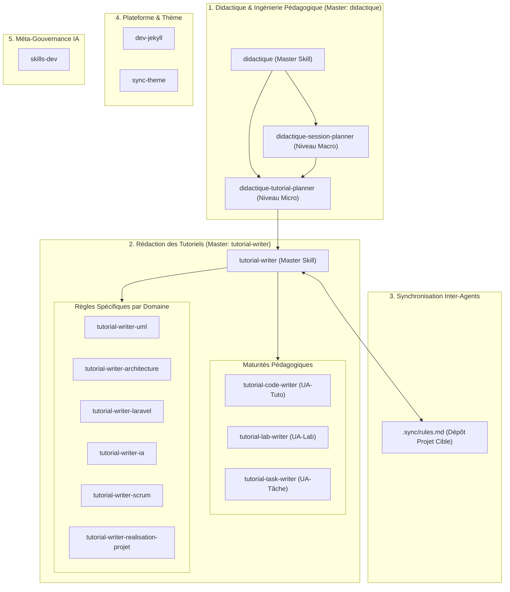

# Écosystème des Compétences IA (`.agents/`) — Plateforme Autoformations

Ce répertoire centralise l'intelligence, les règles didactiques, les références normatives et les **Skills modulaires** qui pilotent le fonctionnement de l'**Agent IA Autoformation** sur la plateforme Solicode.

---

## 1. Cartographie des Compétences IA

L'écosystème s'articule autour de 5 grandes familles fonctionnelles :



| Compétence (Skill) | Vocation Principale | Entités & Fichiers Clés |
| :--- | :--- | :--- |
| **[didactique](skills/didactique/SKILL.md)** | **Master Skill & Chef d'orchestre didactique** : garantit le socle commun tous niveaux N1/N2/N3 (sprints 80h, règle des 3 projets, cycle actif, non-régression des prérequis) et aiguille vers les niveaux Macro et Micro. | `_sessions/`, `_uas/`, `_tutos/` |
| **[didactique-session-planner](skills/didactique-session-planner/SKILL.md)** | **Niveau Macro (Session & Sprint)** : fusionne l'alignement avec le flux réel (`_flux-travail.md`), l'arbitrage de véracité, le cadrage Scrum du sprint de 80h, l'élagage des tâches (10 questions) et la qualification des UAs (`UA-Tâche` / `UA-Lab`). | `_sessions/S[X].md`, `_uas/`, `_flux-travail.md` |
| **[didactique-tutorial-planner](skills/didactique-tutorial-planner/SKILL.md)** | **Niveau Micro (Tutoriels & Progression)** : conçoit la progression pas-à-pas déterministe ($E_{n-1} \to E_n$), formule les titres techniques équilibrés sans entité métier, insère le sas « Bien démarrer » et initialise les stubs Jekyll (`en_construction: true`). | `_plan-réalisation-tutos/`, `_tutos/`, `resources/` |
| **[tutorial-writer](skills/tutorial-writer/SKILL.md)** | **Master Skill & Chef d'orchestre rédactionnel** : gouverne les 12 règles transversales partagées (colonne 0, style A1-A2, UTF-8 sans BOM), route vers les rédacteurs spécialisés et pilote la synchronisation inter-agents. | `_tutos/`, `_plan-tuto-*.md`, `.sync/rules.md` |
| **[tutorial-code-writer](skills/tutorial-code-writer/SKILL.md)** | Rédige les tutoriels d'apprentissage de code incrémental pas-à-pas ($E_{n-1} \to E_n$) avec injecteur interactif `window.pageData`. | `_tutos/...` (`UA-Tuto`) |
| **[tutorial-lab-writer](skills/tutorial-lab-writer/SKILL.md)** | Rédige les ateliers pratiques guidés (notions fondamentales, recherche active, modélisation UML/schémas, outillage IA par skills/prompts). | `_tutos/...` (`UA-Lab`) |
| **[tutorial-task-writer](skills/tutorial-task-writer/SKILL.md)** | Rédige les fiches de cadrage opérationnel et cérémonies agiles de sprint sans aucun apport théorique (0% théorie). | `_tutos/...` (`UA-Tâche`) |
| **[tutorial-writer-uml](skills/tutorial-writer-uml/SKILL.md)** | Rédige les tutoriels UML (diagrammes Mermaid déclaratifs `graph TD`, `sequenceDiagram`, traçabilité Backlog, zéro capture d'écran). | `_tutos/` (domaine `uml`) |
| **[tutorial-writer-architecture](skills/tutorial-writer-architecture/SKILL.md)** | Rédige les tutoriels d'architecture (découpage en couches, fiches ADR, flux de données Mermaid, SOLID, contrôleurs minces). | `_tutos/` (domaine `architecture`) |
| **[tutorial-writer-laravel](skills/tutorial-writer-laravel/SKILL.md)** | Rédige les tutoriels Laravel (Live Coding, FormRequest, Blade/Alpine.js, scission prompt back/front, neutralité de version). | `_tutos/` (domaine `laravel`) |
| **[tutorial-writer-ia](skills/tutorial-writer-ia/SKILL.md)** | Rédige les tutoriels IA & Agents (méthode RIO, méta-prompt générateur, skills modulaires réutilisables). | `_tutos/` (domaine `ia`) |
| **[tutorial-writer-scrum](skills/tutorial-writer-scrum/SKILL.md)** | Rédige les tutoriels Scrum conceptuels (INVEST, MoSCoW, DoD mesurable, notions fondamentales vs recherche active sans mention 20/80). | `_tutos/` (domaine `scrum`) |
| **[tutorial-writer-realisation-projet](skills/tutorial-writer-realisation-projet/SKILL.md)** | Rédige les tâches de projet et cérémonies opérationnelles (maturité UA-Tâche, 0% théorie, journal CLI sans commandes Git). | `_tutos/` (domaine `realisation-projet`) |
| **[dev-jekyll](skills/dev-jekyll/SKILL.md)** | Développe et maintient l'architecture frontend Just the Docs (layouts, includes, CSS/JS, composants interactifs, zéro CSS inline). | `_layouts/`, `_includes/`, `assets/` |
| **[sync-theme](skills/sync-theme/SKILL.md)** | Pilote la synchronisation du socle partagé avec `autoformations-core-theme` via `push_theme.ps1` et `pull_theme.ps1`. | `theme-sync.json`, scripts PowerShell |
| **[skills-dev](skills/skills-dev/SKILL.md)** | Méta-compétence de gouvernance : conçoit, audite et raffine les skills (`.agents/skills/`) et les règles permanentes (`.agents/rules/`). | `.agents/skills/`, `.agents/rules/` |

---

## 2. Guide d'Exécution : Comment Réaliser le Travail de l'Agent

Le travail didactique et technique de l'agent suit un cycle structuré en 5 phases successives :

### Phase 1 : Cadrage de Session & Sprint (Macro Didactique)
Quand une session doit être créée, alignée avec le flux réel du projet ou auditée selon Scrum :
1. Invoquer **`didactique-session-planner`** (ou passer par le Master **`didactique`**) :
   ```markdown
   @[.agents/skills/didactique-session-planner/SKILL.md] Aligne la session _sessions/S1.md avec le flux de travail opérationnel réel et élague les tâches superflues selon Scrum.
   ```
2. L'agent arbitre la véracité (les étapes et livrables réels du projet font autorité ; la didactique certifiante et la durée stricte de 80h de la session font autorité), applique les 10 questions d'élagage, met à jour `_sessions/S[X].md` et produit le **Plan Artefact d'impact sur les UAs**.

### Phase 2 : Planification Fine des Tutoriels & Stubs (Micro Didactique)
Pour structurer et cadencer le parcours pédagogique pas-à-pas des UAs validées :
1. Invoquer **`didactique-tutorial-planner`** :
   ```markdown
   @[.agents/skills/didactique-tutorial-planner/SKILL.md] Conçois et planifie la progression des tutoriels pour la session S1.
   ```
2. L'agent :
   - Établit le plan sans rupture cognitive ($E_{n-1} \to E_n$) reliant le dossier de départ au livrable final complet.
   - Formule des titres H3 purement techniques sans aucune entité métier du projet.
   - Insère le sas « Bien Démarrer » pour toute nouvelle technologie.
   - Crée automatiquement les entités Jekyll manquantes (`_sessions/S[X].md`, `_domaines/`, `_uas/`).
   - Initialise physiquement les fiches stubs de tutoriels sous `_tutos/` avec l'état `en_construction: true`.

### Phase 3 : Rédaction Didactique (Écosystème `tutorial-*-writer`)
Pour rédiger ou affiner le contenu des fiches de tutoriels planifiées :
1. Invoquer le Master Skill **`tutorial-writer`** :
   ```markdown
   @[.agents/skills/tutorial-writer/SKILL.md] Rédige le tutoriel T.321.112 planifié pour l'UA.321.11.
   ```
2. **Double Délégation (Format Didactique & Domaine Technique) :**
   - **Maturité Pédagogique :**
     - Code incrémental pas-à-pas ($E_{n-1} \to E_n$) ➔ **`tutorial-code-writer`** (`UA-Tuto`).
     - Atelier pratique guidé ➔ **`tutorial-lab-writer`** (`UA-Lab`, théorie essentielle, recherche active, modélisation).
     - Tâche opérationnelle ou cérémonie ➔ **`tutorial-task-writer`** (`UA-Tâche`, 0% théorie).
   - **Règles Spécifiques par Domaine :** Injection automatique du skill technique correspondant (`tutorial-writer-uml`, `tutorial-writer-architecture`, `tutorial-writer-laravel`, `tutorial-writer-ia`, `tutorial-writer-scrum`, `tutorial-writer-realisation-projet`).
3. **Application du Socle Transversal (12 Règles Inviolables) :**
   - Encodage strict UTF-8 sans BOM.
   - Blocs de code débutant strictement à la **colonne 0** (zéro espace, saut de ligne avant et après).
   - Chemin relatif canonique `tutoriels/[slug-domaine]/[slug-ua]/[slug-tuto]/` (aucun `README.md` unitaire).
   - Journalisation CLI `[slug-tuto].command.md` sans commandes Git.
   - Respect de l'autonomie Git selon les règles du niveau actif.
   - Zéro fuite de cuisine interne (pas de mention « 20/80 ») et remplacement des jalons par le terme direct « Étape ».

### Phase 4 : Synchronisation Inter-Agents & Traçabilité (`.sync/rules.md`)
Pour synchroniser les tutoriels avec le projet cible réel :
1. Invoquer **`tutorial-writer`** en mode synchronisation :
   ```markdown
   @[.agents/skills/tutorial-writer/SKILL.md] Synchronise les fiches de tutoriels avec le projet cible selon .sync/rules.md.
   ```
2. **Mécanisme Déterministe :**
   - Consultation obligatoire du contrat `<projet-cible>/.sync/rules.md`.
   - Inspection des fichiers `version.yml` logés **exclusivement dans `.sync/`** du projet cible.
   - Comparaison avec le front-matter du tutoriel source (`_tutos/`).
   - Si `.sync` > front-matter : mise à jour du contenu réel, alignement de la version et passage à `statut_realisation: "synchronise"`.
   - Si discordance majeure ou livrable incomplet : passage à `statut_realisation: "a_adapter"`.

### Phase 5 : Maintenance du Site & Évolution des Compétences
- Pour faire évoluer les composants, styles ou layouts Jekyll ➔ Utiliser **`dev-jekyll`**.
- Pour synchroniser le thème partagé avec le dépôt central ➔ Utiliser **`sync-theme`**.
- Pour créer, raffiner ou auditer un skill ou une règle d'agent ➔ Utiliser **`skills-dev`**.

---

## 3. Matrice d'Aiguillage Rapide

| Besoin Exprimé par l'Utilisateur | Compétence à Invoquer |
| :--- | :--- |
| *« Cadrer la session de sprint de 80h et aligner avec le flux réel »* | **`didactique`** (route vers `didactique-session-planner`) |
| *« Auditer et élaguer les activités d'un plan de session selon Scrum »* | **`didactique-session-planner`** |
| *« Planifier la progression fine pas-à-pas des tutoriels et créer les stubs »* | **`didactique`** (route vers `didactique-tutorial-planner`) |
| *« Rédige un tutoriel de code pas-à-pas pour créer un composant »* | **`tutorial-writer`** (route vers `tutorial-code-writer` + `tutorial-writer-laravel`) |
| *« Formalise l'atelier pratique d'architecture et de modélisation »* | **`tutorial-writer`** (route vers `tutorial-lab-writer` + `tutorial-writer-architecture`) |
| *« Modélise les cas d'utilisation ou diagramme de classe Mermaid »* | **`tutorial-writer`** (route vers `tutorial-lab-writer` + `tutorial-writer-uml`) |
| *« Rédige un prompt ou un skill avec la méthode RIO »* | **`tutorial-writer`** (route vers `tutorial-lab-writer` + `tutorial-writer-ia`) |
| *« Rédige la fiche théorique sur la DoD ou le Product Backlog »* | **`tutorial-writer`** (route vers `tutorial-lab-writer` + `tutorial-writer-scrum`) |
| *« Rédige la fiche du rituel de Sprint Planning ou de cadrage »* | **`tutorial-writer`** (route vers `tutorial-task-writer` + `tutorial-writer-realisation-projet`) |
| *« Vérifie l'alignement des versions avec le projet cible »* | **`tutorial-writer`** (via `.sync/rules.md`) |
| *« Améliore l'affichage du layout ou corrige un composant CSS »* | **`dev-jekyll`** |
| *« Synchronise le Core Theme avec le dépôt central »* | **`sync-theme`** |
| *« Crée un nouveau skill ou modifie une règle d'agent »* | **`skills-dev`** |

---

## 4. Règles Transversales Invariables du Workspace

Toute action menée par l'un quelconque de ces skills doit rigoureusement respecter :
1. **Encodage UTF-8 sans BOM :** Obligatoire pour tous les fichiers texte créés ou modifiés.
2. **Documentation Colocalisée (`README.md`) :** Tout skill possède son fichier `README.md` colocalisé unique et suffisant. Aucun sous-dossier `doc/` n'est requis.
3. **Découplage Multi-Niveaux :** Les skills méthodologiques sont agnostiques et résolvent le niveau (N1, N2, N3) et le projet cible à partir de `.agents/rules/`.
4. **Transparence :** Indiquer obligatoirement les skills locaux utilisés et les compétences mobilisées à la fin de chaque réponse.