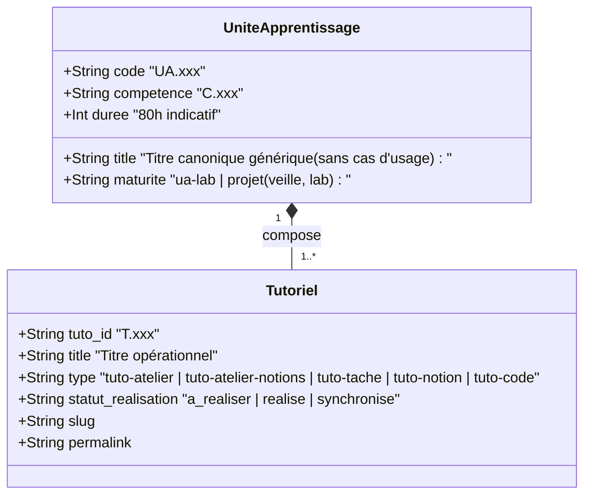
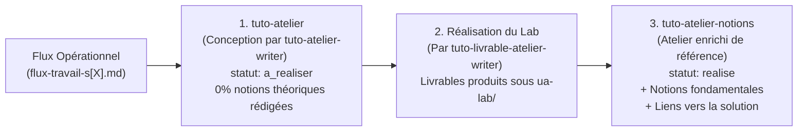

# Référentiel Normatif : Maturation des UAs et Typologie des Tutoriels (EFP)

## 1. Principes Directeurs : UA = Maturité vs Tutoriel = Type

L'ingénierie pédagogique de l'**EFP (Établissement de Formation Professionnelle)** repose sur une dissociation étanche entre deux concepts :



### 1.1 Dissociation Hermétique des Responsabilités
1. **L'Unité d'Apprentissage (`_uas/`) porte exclusivement la MATURITÉ :**
   - **`maturite`** qualifie le stade d'intégration institutionnelle de l'UA dans le référentiel de l'EFP.
   - **Règle fondamentale du flux de travail :** Dans le flux opérationnel d'une session de formation, **toutes les UAs d'ateliers sont formellement de maturité `ua-lab`** (unités officielles du cursus). Il n'existe pas d'UA de maturité `lab` dans le flux de travail d'une session :
     - **`ua-lab`** : Unité d'Apprentissage d'atelier pratique guidé du cursus officiel de formation EFP.
     - **`projet`** : Unité d'Apprentissage d'ingénierie opérationnelle de sprint sur le projet réel (cadrage, backlog, incrément, rituels Scrum, 0% théorie).
     - *(Rappel : `veille` et `lab` sont des stades exploratoires libres hors panier officiel de session).*
2. **Le Tutoriel (`_tutos/`) porte exclusivement le TYPE :**
   - **`type`** qualifie la nature physique, le format d'ingénierie et les livrables attendus de la fiche unitaire de travail (préfixe canonique **`tuto-*`**).
   - Le frontmatter d'un tutoriel ne contient **aucun champ `maturite:`** : sa maturité découle directement de son UA parente.

---

## 2. Typologie Canonique des Ateliers Pratiques : `tuto-atelier` vs `tuto-atelier-notions`

Pour refléter le cycle de vie d'un atelier pratique entre l'autoformation et la réalisation terrain, nous distinguons formellement **deux formats d'ateliers** :



### 2.1 `tuto-atelier` — Atelier Initial Brut (Sans Notions de Base)
- **Définition :** Fiche conçue lors de l'alignement pédagogique initial par le skill `tuto-atelier-writer` à partir du flux opérationnel (`flux-travail-s[X].md`).
- **Contenu :** Contient strictement les informations opérationnelles transmises par le flux de travail :
  - Contexte professionnel et objectifs opérationnels (*Ce que vous devez apprendre*).
  - Travail à faire et déroulement opératoire pas à pas (ateliers, exercices, consignes).
  - Pistes d'approfondissement / recherches actives pour l'apprenant.
  - Livrables attendus (référence vers `ua-lab/[slug-domaine]/[slug-ua]/[slug-tuto]/` sur la plateforme, stockés dans `tutoriels/` sur le poste apprenant).
- **Règle absolue :** **ZÉRO notion théorique détaillée rédigée** (aucun cours magistral préalable).
- **Métadonnées Frontmatter :**
  ```yaml
  type: "tuto-atelier"
  statut_realisation: "a_realiser"
  ```

### 2.2 `tuto-atelier-notions` — Atelier Enrichi (Avec Notions Fondamentales & Solution Réalisée)
- **Définition :** Fiche promue en `tuto-atelier-notions` **après la réalisation effective des livrables** par l'Agent Rédacteur d'Autoformation via le skill `tuto-livrable-atelier-writer`.
- **Contenu :** Une fois les livrables physiques produits sous `ua-lab/`, l'Agent Rédacteur injecte :
  - Le plan des notions de base à voir (les concepts discriminants consolidés par la pratique).
  - Les définitions conceptuelles validées.
  - Les liens vers les livrables physiques et diaporamas complétés sous `ua-lab/` (affichés dans la carte de solution).
- **Métadonnées Frontmatter :**
  ```yaml
  type: "tuto-atelier-notions"
  statut_realisation: "realise" # ou "synchronise"
  livrables:
    - chemin: "ua-lab/[slug-domaine]/[slug-ua]/[slug-tuto]/[slug-tuto].md"
      version: "1.0.0"
    - chemin: "ua-lab/[slug-domaine]/[slug-ua]/[slug-tuto]/presentation-[slug-tuto].md"
      version: "1.0.0"
  ```

### 2.3 Règle du Travail à Faire Différencié dans les Ateliers Enrichis (Logique vs Code)
Afin d'impliquer activement l'apprenant et d'évaluer son assimilation après la mise à disposition de la solution de référence consultable sous `ua-lab/` :
- **Domaines Logiques & Méthodologiques (Scrum, UML, Design Thinking, Architecture) :** L'apprenant consulte la solution TodoList (ou cas modèle) pour appréhender les concepts et la démarche, puis doit obligatoirement **transposer et appliquer cette démarche sur son propre Projet Technique individuel** (choisi au début de la formation). Les livrables de l'apprenant sont rangés dans son espace `tutoriels/[slug-domaine]/...`.
- **Domaines de Codage & Implémentation (Laravel, Alpine.js, Composants front) :** L'apprenant n'a pas à transposer sur un autre projet : il lui suffit d'**implémenter concrètement le code** de l'exemple didactique (TodoList) et de fournir le code source fonctionnel ainsi que son journal de commandes CLI.

---

## 3. Typologie Complète des Formats de Tutoriels (Préfixe `tuto-*`)

### A. `tuto-atelier` & `tuto-atelier-notions` — Ateliers Pratiques Guidés
- **Rattachement :** Unités d'apprentissage de maturité `ua-lab`.
- **Livrables de référence (dans `ua-lab/[slug-domaine]/[slug-ua]/[slug-tuto]/` sur Jekyll, `tutoriels/` sur poste apprenant) :**
  1. Fiche technique d'atelier : `[slug-tuto].md`.
  2. Diaporama Marp de restitution interactif : `presentation-[slug-tuto].md` (`layout: presentation`).
  3. Journal des commandes CLI : `[slug-tuto].command.md` (si des commandes terminal ont été exécutées).
  4. Fichiers de restitution ou ressources d'atelier.
  1. Fiche technique d'atelier : `[slug-tuto].md`.
  2. Diaporama Marp de restitution : `presentation-[slug-tuto].md` (**exclusif au format atelier**).
  3. Journal des commandes CLI : `[slug-tuto].command.md` (si des commandes terminal ont été exécutées).
  4. Fichiers de restitution ou manifestes d'atelier exploratoire.

### B. `tuto-tache` — Tâche Opérationnelle de Projet
- **Rattachement :** Unités d'apprentissage de maturité `projet`.
- **Finalité :** Production concrète de livrables de projet ou réalisation d'un rituel de sprint (note de cadrage, Product Backlog, UI Kit, User Flow, Sprint Planning, Sprint Review, Rétrospective).
- **Règles absolues :**
  - **100% orienté action :** Verbes à l'impératif direct, consignes directes.
  - **0% théorie :** Aucune définition conceptuelle.
  - **Livrables déposés directement aux emplacements racine officiels :**
    - `docs/cadrage/note-cadrage.md`, `docs/conception/ui-kit.md`, `docs/conception/maquettes-sprint-1.md`
    - `scrum/product-backlog.md`
    - `sprints/sprint-[N].md`, `sprints/pv-review-[N].md`, `sprints/retrospective-[N].md`
    - `README.md`, `rapport/`, `presentations/`
  - **Allègement strict :**
    - **Zéro journal des commandes CLI `[slug-tuto].command.md`** (proscrit).
    - **Zéro diaporama Marp de restitution** (sauf soutenance officielle).

### C. `tuto-notion` — Tutoriel de Notion Hors Projet d'Imitation
- **Finalité :** Enseignement d'un concept théorique et pratique isolée en bac à sable, sans impact direct sur l'incrément déployable du projet d'imitation (ex : syntaxe Blade, kata d'algorithmique).
- **Livrables attendus (dans `tutoriels/[slug-domaine]/[slug-ua]/[slug-tuto]/`) :**
  1. Fiche technique d'apprentissage : `[slug-tuto].md`.
  2. Fichiers de code d'exercices ou tests isolés.
  3. Journal des commandes CLI : `[slug-tuto].command.md` (si manipulation CLI).
- **Règle :** **SANS présentation Marp**.

### D. `tuto-code` — Tutoriel de Code sur Projet d'Imitation
- **Finalité :** Développement incrémental de code contribuant directement à l'incrément déployable du sprint sur le projet d'imitation (*Blog des Lauréats* en N3).
- **Livrables attendus :**
  1. **Code source applicatif :** Déposé directement sous **`src/`** (contrôleurs, services, modèles, vues Blade, tests TDD).
  2. **Journal des commandes CLI :** `tutoriels/[slug-domaine]/[slug-ua]/[slug-tuto]/[slug-tuto].command.md`.
- **Règle :** **SANS présentation Marp**.

---

## 4. Matrice de Synthèse & Règles d'Exigence

| Type de Tutoriel (`type:`) | Maturité UA Parente | Statut Initial | Diaporama Marp ? | Journal CLI (`.command.md`) ? | Destination des Livrables |
| :--- | :---: | :---: | :---: | :---: | :--- |
| **`tuto-atelier`** | `ua-lab` | `a_realiser` | **OUI** (`presentation-[slug].md`) | **OUI** (si CLI exécuté) | `ua-lab/.../[slug]/` (Jekyll) / `tutoriels/` (Apprenant) |
| **`tuto-atelier-notions`** | `ua-lab` | `realise` | **OUI** (`presentation-[slug].md`) | **OUI** (si CLI exécuté) | `ua-lab/.../[slug]/` (Jekyll) / `tutoriels/` (Apprenant) |
| **`tuto-tache`** | `projet` | `a_realiser` | **NON** | **NON** (proscrit) | Emplacements racine (`docs/`, `sprints/`, etc.) |
| **`tuto-notion`** | `tutoriel` | `a_realiser` | **NON** | **OUI** (si CLI exécuté) | `tutoriels/.../[slug-tuto]/` |
| **`tuto-code`** | `tutoriel` | `a_realiser` | **NON** | **OUI** (`tutoriels/.../[slug].command.md`) | **`src/`** (arborescence applicative) |

---

## 5. Règle du Journal des Commandes CLI (`[slug-tuto].command.md`)

> [!IMPORTANT]
> Le journal des commandes CLI (`[slug-tuto].command.md`) représente le **rapport d'exécution technique du tutoriel**.  
> - Il atteste que les commandes requises (création de composants, installation de dépendances, migration, compilation d'assets, exécution de tests) ont été rigoureusement exécutées.  
> - Il est strictement réservé aux tutoriels d'apprentissage et d'atelier (`tuto-atelier`, `tuto-atelier-notions`, `tuto-notion`, `tuto-code`).  
> - Il est formellement interdit d'y inclure les commandes de gestion de version Git (`add`, `commit`, `push`).  
> - Il est **strictement proscrit pour les tâches opérationnelles (`tuto-tache`)**.
