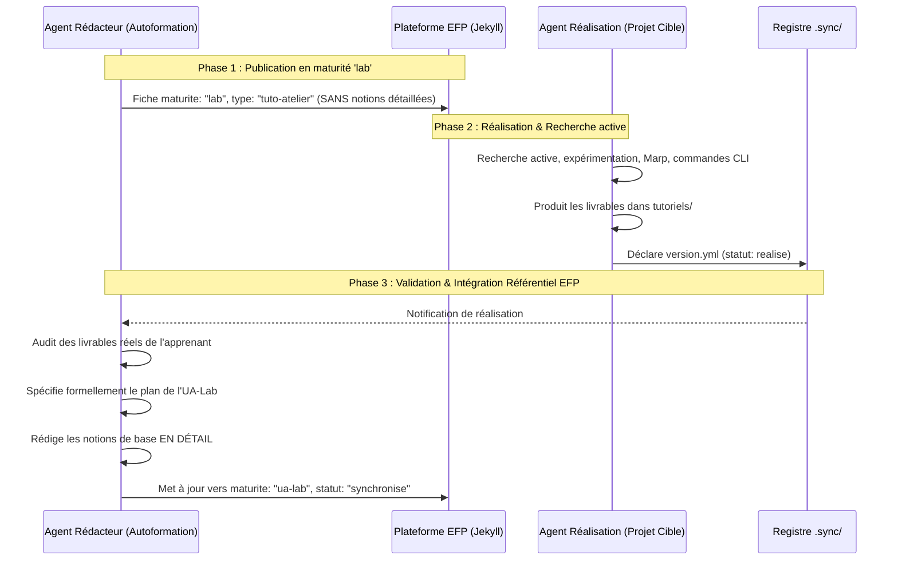

# Référentiel Normatif : Échelle de Maturité EFP & Cycle de Maturation Lab ➔ UA-Lab

## 1. Principes & Séparation Hermétique : Maturité vs Typologie

L'ingénierie didactique de l'**EFP (Établissement de Formation Professionnelle)** repose sur une dissociation absolue entre la **Maturité** et la **Typologie** :

| Dimension | Question Clé | Rôle Pédagogique | Slugs Officiels EFP |
| :--- | :--- | :--- | :--- |
| **`maturite`** | *À quel stade d'évolution et de validation dans le cursus EFP se trouve ce contenu ?* | Niveau d'ancrage institutionnel et de validation sur le terrain | **`veille`**, **`lab`**, **`ua-lab`**, **`tutoriel`**, **`projet`** |
| **`type`** | *Quelle est la structure physique et la nature de ce document didactique ?* | Gabarit, livrables attendus, exigences Marp et CLI | **`tuto-atelier`**, **`tuto-notion`**, **`tuto-code`**, **`tuto-tache`** |

> [!IMPORTANT]
> **Règle Inviolable de Dissociation des Slugs :**
> - Les slugs de maturité et les slugs de type sont **strictement distincts**.
> - Les types de tutoriels adoptent tous le préfixe unifié **`tuto-*`** (`tuto-atelier`, `tuto-notion`, `tuto-code`, `tuto-tache`).
> - Le format d'atelier guidé s'intitule **`tuto-atelier`**. Il est formellement distinct des maturités **`lab`** et **`ua-lab`**.

---

## 2. L'Échelle de Maturité de l'EFP

$$\text{veille} \longrightarrow \text{lab} \longrightarrow \text{ua-lab} \longrightarrow \text{tutoriel} \quad (+\; \text{projet})$$

1. **`veille` :** Recherche exploratoire, prospective technique, identification de nouvelles technologies ou approches sans atelier structuré.
2. **`lab` :** Atelier d'expérimentation pratique guidé. L'apprenant est mis en posture de recherche active. **On ne donne PAS les notions de base en détail**, mais uniquement le travail à faire, les compétences à acquérir et les pistes de recherche.
3. **`ua-lab` :** **Un Lab réalisé, validé sur le terrain par les apprenants, puis officiellement intégré dans le référentiel de compétences de l'EFP**. À ce stade, le plan de l'UA-Lab est formellement spécifié et **les notions de base sont données en détail** (cours théorique de référence consolidé).
4. **`tutoriel` :** Industrialisation didactique complète (découpage déterministe $E_{n-1} \to E_n$, code incrémental autonome).
5. **`projet` :** Dimension transverse d'ingénierie opérationnelle (cadrage, Product Backlog, rituels Scrum, revues et rétrospectives, **0% théorie**).

---

## 3. Matrice de Correspondance : Niveau UA vs Niveau Tutoriel

> [!IMPORTANT]
> **Règle absolue de dissociation :**  
> `ua-lab` est une valeur de maturité **strictement réservée au niveau Unité d'Apprentissage (`_uas/`)**.  
> Un tutoriel n'étant pas une UA, la valeur `ua-lab` n'est **jamais** une maturité de tutoriel.  
> Un tutoriel d'atelier porte toujours la maturité **`maturite: "lab"`** (avec `type: "tuto-atelier"`).

| Niveau d'Entité | Maturité (`maturite:`) | Typologie (`type:`) | Livrables Attendus & Spécificités EFP |
| :--- | :--- | :--- | :--- |
| **UA (`_uas/`)** | **`lab`** | **`UA-Lab`** | Unité d'Atelier en cours d'expérimentation amont. |
| **UA (`_uas/`)** | **`ua-lab`** | **`UA-Lab`** | **Lab validé sur le terrain et intégré au référentiel EFP** : Plan d'UA spécifié avec cours théorique consolidé. |
| **UA (`_uas/`)** | **`projet`** | **`UA-Tâche`** | Unité opérationnelle de sprint (0% théorie). |
| **Tutoriel (`_tutos/`)** | **`lab`** | **`tuto-atelier`** | Atelier pratique guidé : diaporama Marp (`presentation-[slug].md`) + fiche atelier (`[slug].md`) + journal CLI (`[slug].command.md` si CLI) sous `tutoriels/`. |
| **Tutoriel (`_tutos/`)** | **`tutoriel`** | **`tuto-notion`** | Concepts théoriques et notions isolées hors imitation (sous `tutoriels/`, sans Marp, rapport CLI si manipulation). |
| **Tutoriel (`_tutos/`)** | **`tutoriel`** | **`tuto-code`** | Progression incrémentale $E_{n-1} \to E_n$ sur le projet d'imitation (code sous `src/`, sans Marp, rapport CLI sous `tutoriels/`). |
| **Tutoriel (`_tutos/`)** | **`projet`** | **`tuto-tache`** | Tâches de projet opérationnelles et rituels Scrum (0% théorie, fichiers racine `docs/`, `sprints/`, `scrum/`, sans Marp, sans CLI). |

---

## 4. Cycle de Maturation d'un Atelier : `lab` $\longrightarrow$ `ua-lab`

Un document de type **`tuto-atelier`** traverse obligatoirement 3 phases séquentielles :



### Phase 1 : Maturité `lab` (Avant Réalisation — Recherche Active)
L'Agent Rédacteur conçoit le cadre de l'atelier sans prémâcher le travail :
- **Frontmatter Jekyll :**
  ```yaml
  maturite: "lab"
  type: "tuto-atelier"
  statut_realisation: "a_realiser"
  ```
- **Structure Markdown :**
  1. **Contexte & Enjeux :** Pourquoi cette compétence est requise dans le sprint.
  2. **Ce que vous devez apprendre :** Objectifs pédagogiques clairs, problématiques à explorer.
  3. **Travail à faire :** Consignes directives sur les livrables à concevoir et tester.
  4. **Pistes de recherche active :** Questions directrices guidant l'investigation sans donner la solution.
  5. **Livrables attendus :**
     - Fiche d'atelier : `tutoriels/[slug-domaine]/[slug-ua]/[slug-tuto]/[slug-tuto].md`
     - Diaporama Marp : `tutoriels/[slug-domaine]/[slug-ua]/[slug-tuto]/presentation-[slug-tuto].md`
     - Journal CLI : `tutoriels/[slug-domaine]/[slug-ua]/[slug-tuto]/[slug-tuto].command.md` (si CLI)
  - ⚠️ **ZÉRO section « Notions fondamentales » détaillée à cette étape.**

---

### Phase 2 : Réalisation par l'Agent Réalisation de Sprint (`realisation-sprint`)
- L'apprenant prend en charge la fiche en maturité `lab`.
- Il mène l'investigation, produit sa synthèse dans `tutoriels/.../[slug].md`, son diaporama Marp et son journal CLI.
- Il incrémente `.sync/.../version.yml` et notifie `statut_realisation: "realise"`.

---

### Phase 3 : Validation de l'Atelier & Promotion de l'UA en `maturite: "ua-lab"`
- **Déclencheur :** Notification `statut_realisation: "realise"`.
- **Frontmatter de l'UA (`_uas/`) :** L'Unité d'Apprentissage est promue au statut certifiant :
  ```yaml
  maturite: "ua-lab"
  ```
- **Frontmatter du Tutoriel (`_tutos/`) :** Le tutoriel conserve sa maturité d'atelier pratique `lab` et passe au statut synchronisé :
  ```yaml
  maturite: "lab"
  type: "tuto-atelier"
  statut_realisation: "synchronise"
  ```
- **Enrichissements apportés par l'Agent Rédacteur :**
  1. **Audit des livrables :** Vérification de la véracité technique et de la qualité du support Marp.
  2. **Spécification du Plan de l'UA-Lab :** Structuration formelle de la fiche UA dans `_uas/` (articulation des tâches, alignement sur les compétences certifiantes `C.xxx`, promotion en `maturite: "ua-lab"`).
  3. **Notions de base données en détail :** Rédaction de la section **« Notions fondamentales »** dans le tutoriel : cours théorique rigoureux et synthétique (les 20% discriminants vérifiés sur le terrain).
  4. Conservation des pistes d'approfondissement dans « Recherches à effectuer ».
