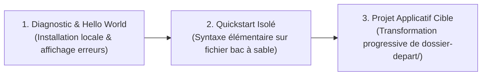

# Méthode Pédagogique « Bien Démarrer » (Sas d'Atterrissage)

Protocole obligatoire lors de l'introduction de tout nouveau langage, runtime, CLI ou framework pour éviter toute rupture cognitive.

## 1. Les Deux Paliers Obligatoires
1. **Palier 1 — Hello World & Diagnostic Environnement :**
   - Vérifier la présence de l'outil (`php -v`, `node -v`, etc.).
   - Activer l'affichage explicite des erreurs (ex: `display_errors = On`, console F12, traceback CLI). Interdiction de coder avec des erreurs masquées.
   - Exécuter un premier script minimal observable (texte simple sur serveur local ou terminal).
2. **Palier 2 — Démarrage Rapide (Quickstart Isolé) :**
   - Manipuler la syntaxe minimale sur un fichier bac à sable autonome (`demo.php`, `test.js`) sans bruit applicatif (zéro CSS, zéro base de données).

## 2. Matrice d'Application par Domaine
| Domaine / Techno | Palier 1 : Hello World & Diagnostic | Palier 2 : Quickstart Isolé | Transition Projet Cible |
| :--- | :--- | :--- | :--- |
| **PHP Procédural** | Installation, `php -v`, `php -S`, `display_errors = On` | `hello.php` avec variable et `echo` | Remplacement de titre dans `index.php` |
| **JavaScript DOM** | Console DevTools F12, `console.log()` | Déclaration `let/const`, `querySelector` | Dynamisation d'éléments du projet |
| **Bases SQL** | Connexion serveur, `SHOW DATABASES;` | Table test et `SELECT 1 + 1;` | Schéma relationnel du projet |
| **Frameworks (React, Laravel)** | Runtime, serveur de dev (`npm run dev`, `artisan serve`) | Composant minimal ou route test | Intégration de la logique métier |

## 3. Checklist Binaire
- [ ] Binaire/runtime formellement vérifié avant tout code projet.
- [ ] Mode debug / affichage des erreurs activé et testé explicitement.
- [ ] Script minimal Hello World exécuté avec succès.
- [ ] Quickstart isolé réalisé avant toute modification du projet d'imitation.
