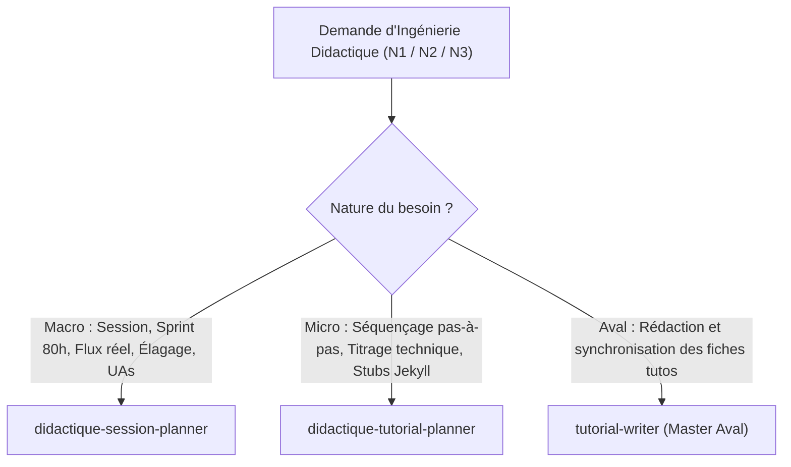

# Master Skill : didactique

## 1. Rôle et Mission
Ce Master Skill est le **chef d'orchestre de l'ingénierie didactique** pour l'ensemble des formations Solicode sur les 3 niveaux de cursus : **N1 (Découvrir)**, **N2 (Prototyper)** et **N3 (Développer / Réaliser)**. Il garantit la cohérence pédagogique amont avant toute rédaction de tutoriels :
1. **Gouvernance du socle didactique** : application des principes d'apprentissage actif adaptés au niveau cible résolu dans `.agents/rules/`.
2. **Orchestration des compétences de conception** : aiguillage ciblé vers le niveau Macro (Session & Sprint) ou le niveau Micro (Tutoriels & Stubs).

## 2. Principes Directeurs Inviolables (Socle Tous Niveaux)
1. **Calibrage Temporel Strict :** Chaque session correspond à un Sprint Scrum calibré à **strictement 80 heures** (10 jours à raison de 8h/jour). La métadonnée `duree: 80` est inviolable.
2. **Pédagogie des 3 Projets :**
   - **Projet 1 — Imitation :** Référence commune guidée pas-à-pas avec le formateur. Les tutoriels rédigés s'appliquent exclusivement à ce projet.
   - **Projet 2 — Technique :** Réalisation autonome par l'apprenant pour reproduire la technique sur son projet individuel (après le sprint).
   - **Projet 3 — Fil Rouge :** Transposition vers une application métier (autonome ou avec Agent IA selon le niveau, après le sprint).
3. **Cycle d'Apprentissage Actif :** $\text{Comprendre} \longrightarrow \text{Reproduire} \longrightarrow \text{Expérimenter} \longrightarrow \text{Réaliser} \longrightarrow \text{Réutiliser}$.
4. **Non-Régression & Zéro Répétition des Prérequis :** Ne jamais introduire de cours théorique sur les notions déjà acquises aux niveaux antérieurs (en N2 : prérequis N1 acquis ; en N3 : prérequis N1 et N2 acquis ; en N1 : apprentissage direct des fondamentaux).
5. **Typologie Didactique Stricte :**
   - **`UA-Tâche` :** Action opérationnelle, cadrage, initialisation outillée, rituels Scrum. **0% théorie.**
   - **`UA-Lab` :** Découverte d'un nouveau paradigme du niveau actif (N1 syntaxe/web, N2 POO/3-tiers, N3 frameworks/SOLID/TDD/IA). Fournit les 20% fondamentaux, 80% en recherche active.
6. **Discrétion Pédagogique :** Interdiction formelle d'exposer la cuisine interne aux apprenants (ne jamais mentionner « 20/80 » ou des durées unitaires dans les fiches destinées aux apprenants).

## 3. Matrice d'Aiguillage Opérationnel
Selon la mission demandée, invoquer immédiatement le sous-skill spécialisé :

- **Besoin Niveau Session / Sprint :** Cadrer la session, aligner avec le flux de travail réel (`_flux-travail.md`), auditer et élaguer les tâches selon Scrum (10 questions), qualifier les UAs (`UA-Tâche` vs `UA-Lab`), mettre à jour `_sessions/S[X].md` ➔ Invoquer **`didactique-session-planner`**.
- **Besoin Niveau Progression / Tutoriels :** Découper la réalisation pas-à-pas sans rupture ($E_{n-1} \to E_n$), formuler des titres équilibrés sans entité métier, insérer le sas « Bien démarrer », matérialiser les entités Jekyll et générer les stubs sous `_tutos/` (`en_construction: true`) ➔ Invoquer **`didactique-tutorial-planner`**.
- **Besoin Rédactionnel Aval :** Rédiger le corps complet des fiches, injecter `window.pageData` et synchroniser avec les livrables du projet cible ➔ Déléguer à **`tutorial-writer`**.

## 4. Contrôle Qualité de l'Orchestrateur
- [ ] Le budget temps de la session est fixé à exactement 80 heures quel que soit le niveau.
- [ ] Le projet d'imitation du niveau actif est la cible exclusive des travaux guidés.
- [ ] Aucun cours théorique n'est réintroduit pour les prérequis validés aux niveaux antérieurs.
- [ ] L'aiguillage respecte la frontière étanche : Macro (`session-planner`) vs Micro (`tutorial-planner`).