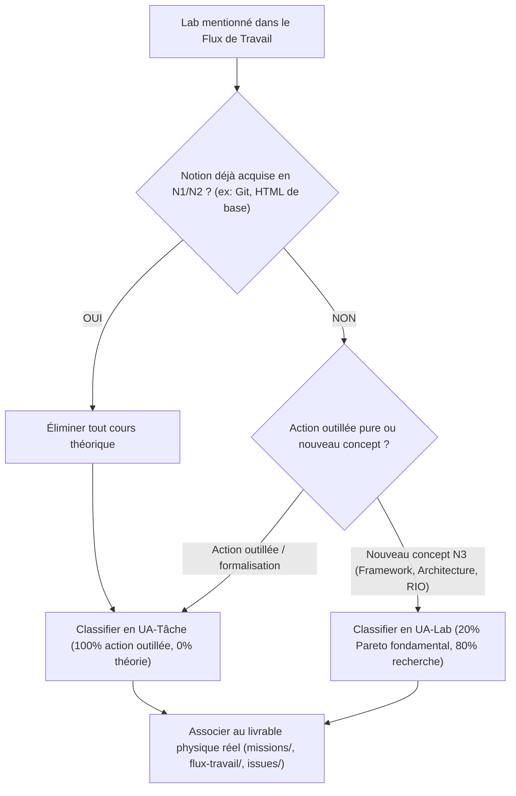

# Session Flux de Travail Adapter

## 1. Rôle et Mission

Ce skill est l'**expert en alignement et réconciliation didactique** entre :
1. Le **flux de travail opérationnel de réalisation de projet** (`_flux-travail.md`), qui décrit les étapes concrètes franchies par l'équipe et l'Agent IA pour fabriquer le produit.
2. La **Session de formation** (`_sessions/S[X].md`), qui organise le parcours pédagogique par compétences au sein du cursus Solicode.

Sa mission consiste à :
- **Identifier l'information juste** : reconnaître ce qui fait autorité dans le flux de travail (la réalité des étapes du projet, les arborescences physiques de livrables `missions/`, `flux-travail/`, `issues/`, les commandes CLI) et ce qui fait autorité dans la session (les compétences officielles, l'aboutissement applicatif, les rituels Scrum).
- **Critiquer et adapter les labs** : analyser les labs bruts listés sous *« Base théorique et pratique »* dans le flux de travail pour les qualifier didactiquement selon les règles N3 (Pareto 20/80, 0 théorie pour les UA-Tâche, élimination des redondances N1/N2).
- **Mettre à jour la session** : restructurer les phases chronologiques, intégrer les étapes réelles et aligner la liste frontmatter `uas:`.
- **Produire un Plan Artefact** : formuler une proposition d'impact structurée détaillant les Unités d'Apprentissage (`_uas/`) et les tutoriels stubs (`_tutos/` avec `en_construction: true`) à créer, modifier ou supprimer.

---

## 2. Règle d'Inviolabilité du Temps (Périmètre Strict)

> [!IMPORTANT]
> **Interdiction formelle d'auditer ou de modifier la durée :**  
> Le rôle de ce skill **n'est en aucun cas d'auditer la durée de la session, de recalculer les heures allouées ou de modifier le budget temps**.  
> - La métadonnée globale `duree:` de la session (ex : `duree: 80`) est strictement inviolable et conservée telle quelle.
> - Le skill ne procède à aucun micro-arbitrage de temps sur les étapes. L'audit et le calibrage temporel fin relèvent exclusivement d'autres skills dédiés (tels que `scrum-pedagogical-plan-adapter` ou `tutorial-planer`).

---

## 3. Matrice d'Arbitrage de Véracité

Lors de la confrontation entre le flux de travail et la session, le skill applique la matrice d'arbitrage suivante :

| Dimension | Vérité dans le Flux de Travail | Vérité dans la Session | Arbitrage Retenu |
| :--- | :--- | :--- | :--- |
| **Étapes de réalisation** | Décrit les étapes réelles exécutées sur le projet (`git init`, outillage IA, formalisation du flux, issues). | Peut omettre les étapes d'outillage initiales ou sauter directement au code. | **Le Flux de travail fait autorité** pour la réalité des étapes de projet. |
| **Livrables physiques** | Référentiel des vrais fichiers produits (`missions/`, `flux-travail/`, `issues/`). | Mentionne parfois des documents abstraits ou déconnectés. | **Le Flux de travail fait autorité** pour l'arborescence et les livrables. |
| **Bases & Labs** | Énumération informelle ou brute (`lab-github`, `lab-prompt-engineering`, etc.). | Cadre formel de granularité pédagogique (UA-Lab, UA-Tâche, domaines `D.XXX.Y`). | **La didactique de la Session fait autorité** : les labs du flux doivent être critiqués et adaptés. |
| **Compétences & Cursus** | Focalisé sur la production du projet en cours. | Porteur des compétences certifiantes officielles (`C.311`, `C.312`, `C.321`, `C.325`, `C.351`). | **La Session fait autorité** pour garantir la trajectoire de compétences N3. |
| **Durée globale** | Non spécifiée ou informelle. | Fixée réglementairement (Sprint Scrum de 80h). | **La Session fait autorité** : la durée `duree: 80` reste inchangée. |

---

## 4. Grille de Critique Didactique des Labs

Pour chaque lab mentionné dans la section *« Base théorique et pratique »* du flux de travail, appliquer rigoureusement les filtres didactiques suivants :



### Règles de Critique :
1. **Élimination des cours redondants sur les prérequis N1/N2 :**  
   Ne jamais introduire de cours ou de tutoriel d'apprentissage théorique pour Git, la gestion des branches ou les bases du Web. Ces compétences sont déjà validées. Toute manipulation de ce type est traitée comme une action outillée directe.
2. **Typologie stricte UA-Lab vs UA-Tâche :**
   - **`UA-Tâche` :** Action de cadrage, d'initialisation outillée (CLI `gh`), de formalisation de fichiers ou de cérémonies Scrum. **Zéro théorie.**
   - **`UA-Lab` :** Découverte d'un nouveau paradigme ou outil d'ingénierie (Prompt Engineering RIO, architecture en couches, contrôleur HTTP Laravel). Applique la règle des **20/80 de Pareto** (fournir les 20% discriminants, l'apprenant recherche les 80% complémentaires).
3. **Articulation avec les dossiers réels :**  
   Remplacer tout livrable verbal ou abstrait par la matérialisation dans les dossiers du projet :
   - Initialisation projet ➔ `missions/1.init-projet.mission.md`, `README.md`.
   - Agent IA ➔ `missions/init-ia.mission.md`, `missions/init-agent.mission.md`, `missions-creator.mission.md`, `missions-index.yml`.
   - Flux de travail ➔ `flux-travail/flux-travail.md`, `missions/flux-travail.mission.md`.
   - Planification agile ➔ dossier `issues/` (`issues-open.md`, `issues-à-valider.md`, `issues-closes.md`).

---

## 5. Procédure Pas-à-Pas d'Exécution

### Étape 1 : Lecture & Cartographie
1. Charger le document source de flux de travail (`_flux-travail.md`).
2. Charger la session cible (`_sessions/S[X].md`).
3. Inventorier les UAs existantes associées dans `_uas/` et les tutoriels dans `_tutos/`.

### Étape 2 : Critique des Labs & Qualification des UAs
Pour chaque étape du flux de travail :
- Auditer les éléments de la *« Base théorique et pratique »*.
- Attribuer une décision didactique :
  - **Créer une nouvelle UA** (spécifier code, domaine `D.XXX.Y`, titre, maturité `UA-Lab` ou `UA-Tâche`, livrable).
  - **Adapter une UA existante** (ajuster le périmètre et pointer vers les livrables réels).
  - **Conserver une UA existante** (maintenir sans altération).
  - **Supprimer / Fusionner** toute UA devenue obsolète ou redondante.

### Étape 3 : Mise à Jour de la Session (`_sessions/S[X].md`)
1. **Front Matter :**
   - Mettre à jour la collection `uas:` avec la liste ordonnée des codes UA réels.
   - Actualiser `objectif:` et `description:` pour refléter les étapes réelles intégrées.
   - **Conserver la valeur de `duree:` intacte.**
2. **Corps de la Session :**
   - Réorganiser les phases chronologiques (Phase A : Outillage/Initialisation/Méthode, Phase B : Cadrage/Analyse/Backlog/Issues, Phase C : Réalisation applicative, Phase D : Clôture).
   - Décrire chaque étape avec son titre, son code UA, sa maturité, et ses livrables physiques précis.
   - Préserver rigoureusement l'aboutissement applicatif de la session (ex : Laravel 12, architecture 2 couches, Live Coding).

### Étape 4 : Production du Plan Artefact
Générer un Plan Artefact destiné au concepteur pédagogique détaillant :
1. **La synthèse des arbitrages** : ce qui a été extrait du flux de travail et ce qui a été conservé de la session.
2. **La matrice d'impact des Unités d'Apprentissage (`_uas/`)** : tableau comparatif complet (Action, Code UA, Domaine, Maturité, Titre, Livrable).
3. **La matrice d'impact des Tutoriels (`_tutos/`)** : liste des tutoriels stubs à créer (`en_construction: true`), à adapter ou à déprécier.

---

## 6. Format de Sortie du Plan Artefact

Le Plan Artefact produit respecte le gabarit suivant :

```markdown
# Plan Artefact : Impact Référentiel Session S[X] ➔ UAs & Tutoriels

## 1. Synthèse de l'Arbitrage Didactique
- Étapes du flux de travail intégrées : [Liste]
- Livrables physiques officialisés : [missions/, flux-travail/, issues/]
- Durée globale de session préservée : [duree] heures

## 2. Matrice d'Impact des Unités d'Apprentissage (_uas/)
| Action | Code UA | Domaine | Maturité | Titre | Livrable Principal |
|---|---|---|---|---|---|
| CRÉER | UA.XXX.XX | D.XXX.Y | UA-Tâche / UA-Lab | [Titre] | [Livrable] |
| MODIFIER | UA.XXX.XX | D.XXX.Y | UA-Lab | [Titre] | [Livrable] |
| CONSERVER | UA.XXX.XX | D.XXX.Y | UA-Lab | [Titre] | [Livrable] |

## 3. Matrice d'Impact des Tutoriels (_tutos/)
### Tutoriels à créer (Stubs en_construction: true) :
- `_tutos/[Domaine]/[UA]/[Code-Tuto]/[slug].md`
### Tutoriels à adapter :
- `_tutos/[Domaine]/[UA]/[Code-Tuto]/[slug].md`
```

---

## 7. Contrôle Qualité

- [ ] L'encodage de tous les fichiers créés ou modifiés est en **UTF-8 sans BOM**.
- [ ] La durée globale de la session (`duree:`) n'a **pas** été modifiée ni auditée.
- [ ] Les étapes 1..N du flux de travail sont représentées avec leurs livrables réels (`missions/`, `flux-travail/`, `issues/`).
- [ ] Aucun cours théorique redondant n'a été introduit pour les notions déjà validées en N1/N2.
- [ ] Les nouvelles UAs d'action outillée sont qualifiées en **UA-Tâche** (0% théorie).
- [ ] Les UAs introduisant un nouveau concept sont qualifiées en **UA-Lab** (20/80 Pareto).
- [ ] La liste `uas:` dans le Front Matter de la session est exhaustive et ordonnée.
- [ ] Le Plan Artefact d'impact sur les UAs et tutoriels est complet et prêt pour validation.
