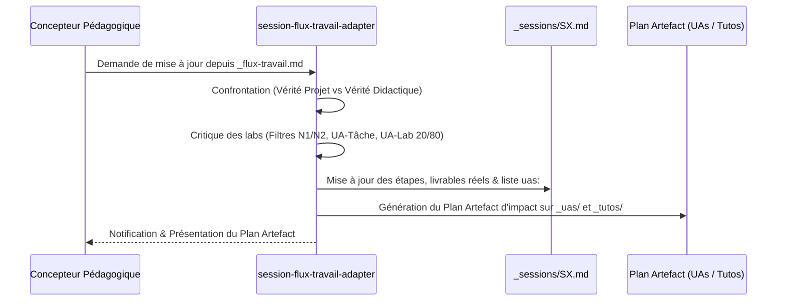

# Guide d'Utilisation du Skill : `session-flux-travail-adapter`

## 1. Rôle et Valeur Ajoutée

Le skill **`session-flux-travail-adapter`** est l'ingénieur pédagogique chargé de réconcilier et d'aligner le **flux de travail opérationnel de projet** (`_flux-travail.md`) avec la **Session de formation** (`_sessions/S[X].md`).

Dans la pratique de formation professionnelle Solicode N3 :
- Le chef de projet et l'Agent IA formalisent dans le flux de travail les **étapes réelles de réalisation du projet** et les livrables physiques associés (`missions/`, `flux-travail/`, `issues/`).
- La session de formation cadre le parcours d'apprentissage certifiant (compétences N3, framework, architecture logicielle, rituels Scrum).

Ce skill assure la passerelle entre ces deux référentiels :
1. Il identifie les informations justes dans chaque document.
2. Il critique didactiquement les labs informels de la section « Base théorique et pratique ».
3. Il met à jour la session en intégrant les étapes réelles.
4. Il produit un **Plan Artefact** proposant les modifications du référentiel pédagogique (créations, modifications, suppressions d'UAs et de tutoriels).
5. **Règle d'inviolabilité :** Il n'audite pas la durée de la session et ne modifie pas les heures allouées.

---

## 2. Cas d'Usage Principaux

- **Initialisation ou évolution d'un projet :** Lorsque de nouvelles étapes de réalisation sont formalisées dans `_flux-travail.md` et doivent être répercutées dans la session de formation correspondante.
- **Réconciliation didactique :** Lorsqu'il existe une discordance entre les livrables demandés aux apprenants sur le projet d'imitation et la fiche de session.
- **Qualification didactique des labs :** Pour transformer des labs bruts de travail en véritables Unités d'Apprentissage conformes aux standards N3 (`UA-Tâche` opérationnelle sans théorie, ou `UA-Lab` avec 20/80 Pareto).

---

## 3. Prompts Types pour Invoquer le Skill

### Cas 1 : Alignement complet d'une session depuis le flux de travail
```text
À l'aide du skill session-flux-travail-adapter, mets à jour la Session S1 en te basant sur le flux de travail _flux-travail.md. 
Arbitre les informations justes, critique et adapte les labs à faire, mets à jour la session sans modifier la durée globale, et propose le Plan Artefact d'impact sur les UAs et les tutoriels.
```

### Cas 2 : Audit et critique des labs d'un flux de travail
```text
Utilise session-flux-travail-adapter pour analyser la section 'Base théorique et pratique' de _flux-travail.md pour le Sprint 1. 
Identifie les faux labs à éliminer (acquis N1/N2), qualifie les étapes en UA-Tâche ou UA-Lab, et propose leur intégration dans _sessions/S1.md.
```

---

## 4. Prérequis & Fichiers d'Entrée

Pour fonctionner correctement, le skill nécessite :
1. **Le document source du flux de travail :** `_flux-travail.md` (ou fichier d'étape équivalent).
2. **La fiche de session cible :** `_sessions/S[X].md`.
3. **Le référentiel pédagogique existant :**
   - Collections `_domaines/`
   - Collection `_uas/`
   - Collection `_tutos/`
4. **Les règles permanentes de pédagogie N3 :** `.agents/rules/pedagogie-spartel-n3.md` et `.agents/rules/standards-techniques.md`.

---

## 5. Déroulement Pas-à-Pas



1. **Chargement et confrontation :** Comparer les étapes et livrables du flux avec ceux de la session.
2. **Critique des labs :**
   - Écarter tout cours théorique sur les compétences N1/N2 (Git, branches, HTML/CSS de base).
   - Définir si l'étape est une **UA-Tâche** (ex: configuration GitHub CLI, écriture de flux) ou une **UA-Lab** (ex: Prompt Engineering RIO, architecture 2 couches).
3. **Mise à jour de la session :** Réécrire les étapes, intégrer les dossiers livrables réels (`missions/`, `flux-travail/`, `issues/`), actualiser `uas:`, en conservant `duree: [X]` intacte.
4. **Formulation du Plan Artefact :** Spécifier les fiches `.md` d'UAs et de tutoriels à créer, adapter ou déprécier.

---

## 6. Vérification des Livrables

Après l'exécution du skill, vérifier :
- [ ] La session `_sessions/S[X].md` intègre les étapes réelles du flux de travail.
- [ ] La métadonnée `duree:` de la session n'a pas été modifiée.
- [ ] Les livrables pointent vers les dossiers physiques réels (`missions/`, `flux-travail/`, `issues/`).
- [ ] La liste frontmatter `uas:` est alignée avec les UAs du parcours.
- [ ] Le Plan Artefact d'impact sur les UAs et les tutoriels est disponible et explicite les actions (CRÉER, MODIFIER, CONSERVER, SUPPRIMER).
- [ ] Tous les fichiers sont encodés en **UTF-8 sans BOM**.
