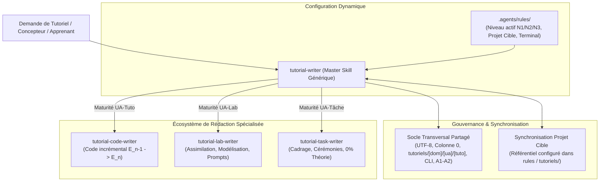
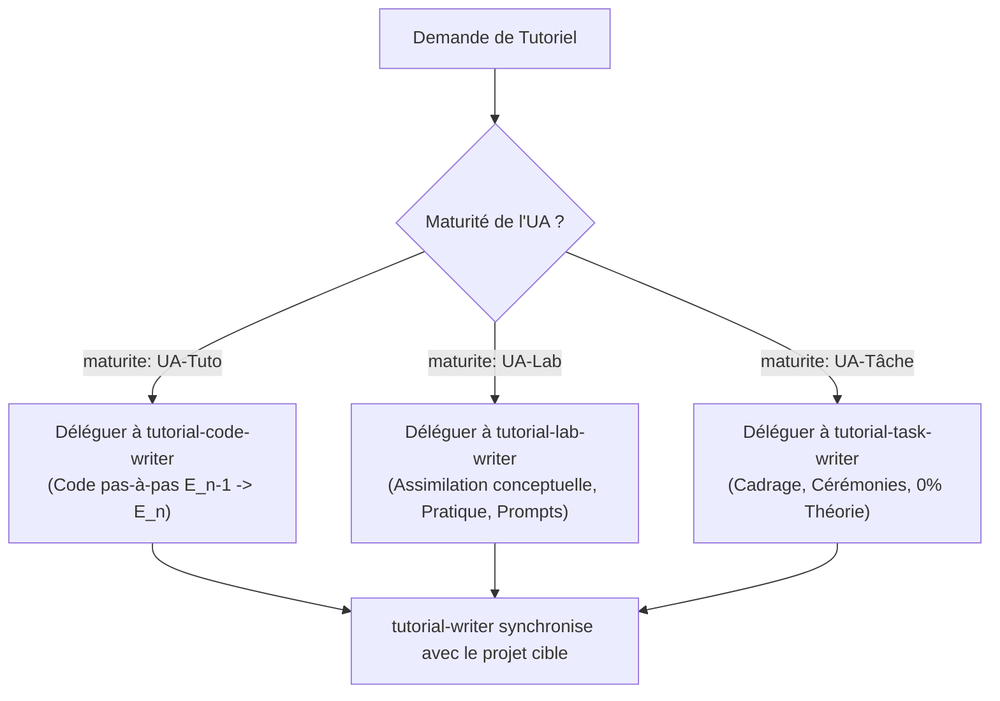

# 1. Mission
Ce skill est le **Master Skill et chef d'orchestre** chargé de la conception, de la gouvernance didactique et de la synchronisation globale des tutoriels au sein des parcours d'apprentissage Solicode.

Il opère de manière **générique et indépendante du niveau**, s'adaptant dynamiquement aux niveaux d'apprentissage (**N1 Découvrir, N2 Prototyper, N3 Développer / Réaliser**) et au projet cible tels que configurés dans les directives du projet (`.agents/rules/`) et les ressources de niveau (`.agents/resources/[niveau]/`).

Il assure une triple responsabilité cardinale :
1. **Gouvernance du Socle Transversal Partagé :** Il définit et fait respecter l'ensemble des règles invariables communes à tous les types de tutoriels (encodage, formatage Markdown, arborescence canonique des livrables, journalisation CLI, conventions de langage et niveau A1–A2).
2. **Aiguillage et Routage Didactique :** Il qualifie la maturité de l'Unité d'Apprentissage ou de la tâche demandée et délègue la rédaction au sous-skill spécialisé de l'écosystème **`tutorial-*-writer`** :
   - **`tutorial-code-writer`** pour les tutoriels de code incrémental pas-à-pas (`UA-Tuto`, progression $E_{n-1} \to E_n$).
   - **`tutorial-lab-writer`** pour les ateliers guidés d'assimilation conceptuelle, de modélisation et d'outillage IA (`UA-Lab`).
   - **`tutorial-task-writer`** pour les fiches opérationnelles de cadrage et cérémonies agiles (`UA-Tâche`, 0% théorie).
3. **Autorité Unique de Synchronisation avec le Projet Cible :** Il détient la responsabilité exclusive d'inspecter le dépôt de travail ou projet cible configuré dans `.agents/rules/`, de valider la concordance des livrables et de synchroniser en miroir les fiches de tutoriels et les fichiers physiques correspondants sous `tutoriels/`.



---

# 2. Déclenchement & Limites
- **Quand l'activer :**
  - Toute demande de création, révision ou refactorisation de tutoriels sur la plateforme d'autoformation, quel que soit le niveau d'apprentissage actif.
  - Audit et vérification de conformité des fiches de tutoriels avec les standards Solicode et les règles actives du projet.
  - **Synchronisation entre les tutoriels du site et les livrables physiques du projet cible configuré** (*« Synchronise les livrables avec les tutoriels »*, *« Vérifie la cohérence entre tutoriels/ et le projet cible »*).
  - Routage initial d'un besoin de formation vers le rédacteur technique spécialisé approprié.
- **Quand NE PAS l'activer :**
  - Planification globale d'une session et création de stubs `en_construction: true` ➔ Utiliser [tutorial-planer](../tutorial-planer/SKILL.md).
  - Alignement d'une session avec le document de flux de travail opérationnel ➔ Utiliser [session-flux-travail-adapter](../session-flux-travail-adapter/SKILL.md).
  - Développement frontend ou layouts Jekyll de la plateforme ➔ Utiliser [dev-jekyll](../dev-jekyll/SKILL.md).
  - Synchronisation du socle technique partagé avec `autoformations-core-theme` ➔ Utiliser [sync-theme](../sync-theme/SKILL.md).

---

# 3. Entrées & Ressources à Charger
- **Configuration Dynamique du Niveau & du Projet :**
  - Directives du niveau actif dans `.agents/rules/` (ex: `pedagogie-spartel-n3.md` ou équivalent N1/N2).
  - Standards techniques et chemin du projet cible configuré dans `.agents/rules/standards-techniques.md`.
  - Profil didactique du niveau sous `.agents/resources/[niveau]/` (le cas échéant).
- **Projet Cible & Référentiel de Travail :**
  - Dépôt physique du projet d'application ou d'imitation spécifié dans les règles actives.
  - Arborescence des livrables d'apprentissage sous `tutoriels/` du projet cible.
- **Plans de Réalisation & Sessions :**
  - Plan de réalisation du domaine ou de la session active.

---

# 4. Contraintes & Règles Inviolables Partagées (Le Socle Commun)
Tous les rédacteurs spécialisés (`tutorial-code-writer`, `tutorial-lab-writer`, `tutorial-task-writer`) appliquent obligatoirement ce socle sous l'autorité de `tutorial-writer` :

1. **Encodage Strict (UTF-8 Sans BOM) :**
   Tous les fichiers créés ou modifiés (`.md`, `.command.md`, code source) doivent impérativement être encodés en **UTF-8 sans BOM**.
2. **Formatage Strict des Blocs de Code (Zéro Espace & Ligne Vide) :**
   Tout bloc de code (fenced code block ```` ``` ```` ou ```` ```` ````) doit impérativement débuter à la marge gauche (**colonne 0, strictement sans espaces d'indentation**), y compris sous un élément de liste ordonnée. Toujours laisser une ligne vide avant d'ouvrir un bloc et une ligne vide après sa fermeture.
3. **Arborescence Canonique des Livrables (`tutoriels/`) :**
   Tout livrable d'apprentissage doit obligatoirement être spécifié avec son chemin relatif complet sous l'arborescence standardisée :
   `tutoriels/[slug-domaine]/[slug-ua]/[slug-tuto]/`
   - **Interdiction formelle des dossiers orphelins :** Proscrire tout dossier racine alternatif comme `labs/` (toujours employer `tutoriels/`).
   - **Interdiction des fichiers `README.md` dans les sous-dossiers de tutoriels :** Les dossiers de tutoriels unitaires ne comportent jamais de `README.md`. Le document technique est directement `[slug-tuto].md` (et sa présentation `presentation-[slug-tuto].md`).
   - **Interdiction formelle des formulations vagues :** Ne jamais employer de mentions floues telles que *« journal d'apprentissage personnel »* sans fournir le chemin complet explicite.
4. **Journalisation CLI Standardisée (`[slug-tuto].command.md`) :**
   - Dès qu'un tutoriel implique l'exécution de commandes en ligne de commande, l'apprenant consigne ses commandes dans le fichier dédié `[slug-tuto].command.md` sous `tutoriels/[slug-domaine]/[slug-ua]/[slug-tuto]/`.
   - Les commandes sont affichées directement sous la forme d'un bloc ```` ```bash ```` (sans double encapsulation).
   - Le journal consigne uniquement les commandes opérationnelles utiles de la tâche : **interdiction formelle d'y inclure les commandes d'administration Git (`git add`, `git commit`, `git push`)**.
   - S'il n'y a aucune commande CLI à exécuter, omettre entièrement cette section et le fichier journal.
5. **Environnement Système & Syntaxe des Commandes :**
   - L'environnement par défaut et le terminal sont dictés par les règles actives du projet (`.agents/rules/`).
   - Les commandes fournies doivent adopter une syntaxe universelle et compatible avec le terminal configuré (ex: `mkdir`, redirection standard `echo "" > <fichier>`, en proscrivant les commandes non portables comme `touch` sous PowerShell ou `New-Item`).
6. **Gestion du Versionnement Git selon les Règles du Niveau Actif :**
   - Les consignes de versionnement Git respectent strictement les prérequis définis dans `.agents/rules/` pour le niveau courant.
   - Si les règles du niveau actif stipulent l'autonomie Git (ex: niveaux intermédiaires ou avancés ayant validé les fondamentaux), il est formellement interdit d'imposer des étapes directives de commit ou de push (`git add`, `git commit`, `git push`) à la fin des tutoriels.
   - Si les règles du niveau actif stipulent un apprentissage dirigé de Git (ex: découverte en N1), appliquer les consignes pédagogiques prescrites par la règle locale.
7. **Ciblage du Projet d'Application / d'Imitation Actif :**
   Dans toutes les fiches de tutoriels, les consignes, exemples et livrables s'appliquent au projet cible d'apprentissage en cours défini par les règles du projet (`.agents/rules/`).
8. **Interdiction de Divulguer la Cuisine Interne Pédagogique :**
   Interdiction stricte d'exposer des formulations didactiques internes (telles que *« 20/80 »*, *« Règle des 20/80 »*, *« Les 20%... »*, *« Les 80%... »* ou *« (Ce que l'Apprenant Doit Produire) »*) dans les titres, sous-titres ou corps des tutoriels. Utiliser des intitulés professionnels directs : *« Notions fondamentales »* (ou *« Concepts essentiels »*) pour le socle fourni et *« Recherches à effectuer »* (ou *« Pistes d'approfondissement »*) pour la recherche active.
9. **Interdiction Formelle du Terme « Jalon » :**
   Dans tous les tutoriels destinés aux apprenants, utiliser exclusivement le terme direct **« Étape »** (`1. **Étape 1 — ... :**`). Le terme *« Jalon »* est proscrit.
10. **Neutralité Technologique & Versions :**
    Désigner les frameworks et outils simplement par leur nom générique (ex: `Laravel`, `Alpine.js`), sans y adjoindre de numéro de version éphémère dans le corps des tutoriels. Les versions exactes résident exclusivement dans la documentation de stack technique du projet cible (`README.md`).
11. **Exclusion des Dossiers d'Ingénierie Formateur :**
    Les dossiers d'ingénierie formateur (tels que `flux-travail/`) ne doivent pas être transmis aux apprenants ni figurer dans les commandes de création de dossiers (`mkdir`) de leurs tutoriels.
12. **Zéro Capture d'Écran comme Livrable :**
    Le livrable est toujours du code source ou du markdown versionné sur le dépôt du projet.

---

# 5. Procédure d'Aiguillage & Routage Didactique
Lorsqu'une demande de rédaction de tutoriel est formulée, `tutorial-writer` identifie la maturité pédagogique et applique le routage suivant :



### Critères de Routage :
1. **`UA-Tuto` ➔ [tutorial-code-writer](../tutorial-code-writer/SKILL.md) :**
   - Objectif : Apprentissage pas-à-pas de code incrémental ($E_{n-1} \to E_n$), manipulation de code élémentaire, éditeur interactif avec `window.pageData`.
2. **`UA-Lab` ➔ [tutorial-lab-writer](../tutorial-lab-writer/SKILL.md) :**
   - Objectif : Atelier pratique guidé combinant notions fondamentales, recherche active de l'apprenant, modélisation (UML / schémas), et outillage par skills ou prompts réutilisables.
3. **`UA-Tâche` ➔ [tutorial-task-writer](../tutorial-task-writer/SKILL.md) :**
   - Objectif : Tâche opérationnelle de projet, cadrage ou rituel agile sans aucun apport théorique (0% théorie).

---

# 6. Protocole de Synchronisation du Référentiel Cible
`tutorial-writer` détient la responsabilité exclusive de maintenir la cohérence déterministe entre la plateforme de tutoriels et le projet cible réel :

1. **Étape 1 — Résolution Dynamique du Référentiel Cible :**
   - Charger l'emplacement du projet cible configuré dans `.agents/rules/` (ou les variables d'environnement du projet).
   - Identifier la branche de travail active.
2. **Étape 2 — Synchronisation en Miroir (Plateforme ➔ Projet Cible) :**
   - Dès qu'une fiche de tutoriel `[slug-tuto].md` est créée ou révisée, `tutorial-writer` vérifie ou crée le dossier correspondant sous `tutoriels/[slug-domaine]/[slug-ua]/[slug-tuto]/` dans le projet cible.
   - Y synchroniser la fiche technique `[slug-tuto].md`, sa présentation Marp `presentation-[slug-tuto].md` et son journal `[slug-tuto].command.md` si existant.
3. **Étape 3 — Rétro-Synchronisation (Projet Cible ➔ Plateforme) :**
   - Si les livrables physiques du projet cible évoluent (fichiers de code, scripts, arborescences réelles), `tutorial-writer` actualise les fiches de tutoriels et les critères d'acceptation sur la plateforme.
4. **Étape 4 — Résolution des Incohérences :**
   - Le code et les livrables réels du projet cible font autorité sur les chemins et scripts ; `tutorial-writer` réconcilie les fiches pour garantir l'absence de divergence.

---

# 7. Format de Sortie & Frontmatter Jekyll Canonique
Toute fiche de tutoriel publiée sous `_tutos/` respecte le frontmatter YAML suivant :

```markdown
---
layout: tuto
title: "Titre Explicite du Tutoriel"
sous_titre: "Sous-titre technique synthétique"
tuto_id: "T.XXX.YYY"
ua: "UA.XXX.YY"
nav_order: 10
simplified: true
---
```

---

# 8. Contrôle Qualité & Checklist Globale
Avant de valider tout tutoriel produit par l'écosystème :
- [ ] Le fichier est strictement encodé en **UTF-8 sans BOM**.
- [ ] Tous les blocs de code débutent à la **colonne 0** (aucun espace d'indentation) et sont isolés par des lignes vides.
- [ ] Le livrable est spécifié avec son chemin canonique `tutoriels/[slug-domaine]/[slug-ua]/[slug-tuto]/`.
- [ ] Aucun fichier `README.md` n'est créé dans le sous-dossier de tutoriel unitaire.
- [ ] Les commandes CLI sont consignées dans `[slug-tuto].command.md` selon le terminal configuré dans les règles.
- [ ] Le versionnement Git respecte les prérequis du niveau actif définis dans `.agents/rules/`.
- [ ] Les termes internes « 20/80 » ou « Jalon » sont strictement absents du texte.
- [ ] Le tutoriel est rédigé de manière générique et ne contient aucun chemin physique codé en dur.
- [ ] La synchronisation miroir avec le dossier `tutoriels/` du projet cible a été vérifiée et exécutée.

---

# 9. Gestion des Erreurs Fréquentes
| Erreur Constatée | Cause | Solution Immédiate par `tutorial-writer` |
| :--- | :--- | :--- |
| Chemin physique absolu hardcodé dans le tutoriel | Non-respect de la généricité | Utiliser exclusivement le chemin relatif canonique `tutoriels/[slug-domaine]/[slug-ua]/[slug-tuto]/` |
| Bloc de code indenté sous une puce ou liste | Formatage Markdown incorrect | Aligner strictement à la colonne 0 avec une ligne vide avant et après |
| Dossier de livrable nommé `labs/` | Référencement obsolète | Remplacer systématiquement par `tutoriels/[slug-domaine]/[slug-ua]/[slug-tuto]/` |
| Étape de commit/push imposée alors que le niveau actif prescrit l'autonomie | Mauvaise prise en compte des règles du niveau | Supprimer l'étape conformément aux règles du niveau configuré dans `.agents/rules/` |
| Mention de « Règle des 20/80 » dans le texte | Fuite de cuisine interne didactique | Remplacer par « Notions fondamentales » et « Recherches à effectuer » |
| Divergence entre le site et le projet cible | Oubli de synchronisation | Exécuter la synchronisation miroir dans le projet cible configuré |

---

# 10. Exemples Concrets d'Aiguillage
1. **Cas 1 (Code incrémental) :** L'utilisateur demande *« Rédige le tutoriel pour créer le composant de pagination dynamique »*  
   ➔ Maturité `UA-Tuto` ➔ Aiguillage vers **`tutorial-code-writer`** ➔ Contrôle du socle transversal ➔ Synchronisation dans le projet cible.
2. **Cas 2 (Atelier guidé) :** L'utilisateur demande *« Rédige l'atelier d'initiation à l'architecture et modélisation du domaine »*  
   ➔ Maturité `UA-Lab` ➔ Aiguillage vers **`tutorial-lab-writer`** ➔ Application des notions fondamentales et recherches ➔ Synchronisation dans le projet cible.
3. **Cas 3 (Tâche opérationnelle) :** L'utilisateur demande *« Formalise la fiche du rituel de cadrage et lancement du sprint »*  
   ➔ Maturité `UA-Tâche` ➔ Aiguillage vers **`tutorial-task-writer`** ➔ 0% théorie, déroulement opérationnel ➔ Synchronisation dans le projet cible.
