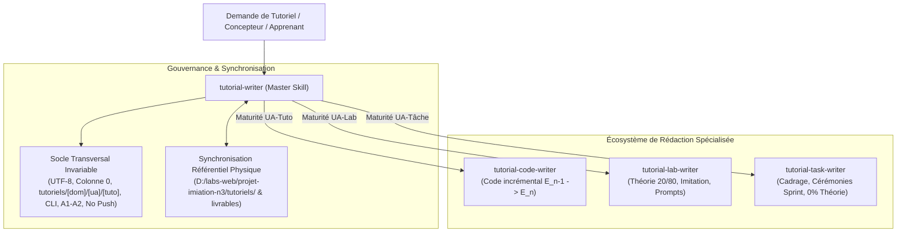
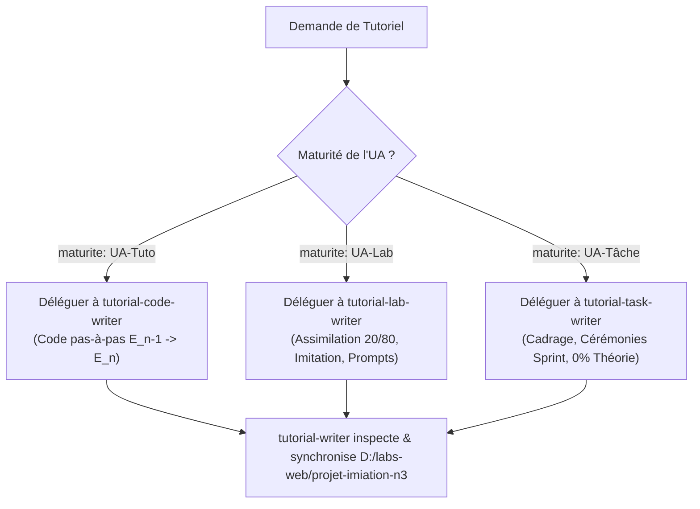

# 1. Mission
Ce skill est le **Master Skill et chef d'orchestre** chargé de la conception, de la gouvernance didactique et de la synchronisation globale des tutoriels du cursus Solicode (Niveau N3 Développer / Réaliser).

Il assure une triple responsabilité cardinale :
1. **Gouvernance du Socle Transversal Partagé :** Il définit et fait respecter l'ensemble des règles invariables communes à tous les types de tutoriels (encodage, mise en page Markdown, arborescence canonique des livrables, journalisation CLI, conventions de langage et niveau A1–A2).
2. **Aiguillage et Routage Didactique :** Il qualifie la maturité de l'Unité d'Apprentissage ou de la tâche demandée et délègue la rédaction au sous-skill spécialisé de l'écosystème **`tutorial-*-writer`** :
   - **`tutorial-code-writer`** pour les tutoriels de code incrémental pas-à-pas (`UA-Tuto`, progression $E_{n-1} \to E_n$).
   - **`tutorial-lab-writer`** pour les ateliers guidés d'assimilation conceptuelle, de modélisation et d'outillage IA (`UA-Lab`, Pareto 20/80, stack Laravel/Alpine).
   - **`tutorial-task-writer`** pour les fiches opérationnelles de cadrage et cérémonies agiles de sprint (`UA-Tâche`, 0% théorie).
3. **Autorité Unique de Synchronisation avec le Référentiel Physique :** Il détient la responsabilité exclusive d'inspecter le dépôt réel du **Projet d'imitation** (`D:\labs-web\projet-imiation-n3` ou `E:\labs-web\projet-imiation-n3`), de valider la concordance des livrables de sprint et de synchroniser en miroir les fiches de tutoriels et les fichiers physiques correspondants sous `tutoriels/`.



---

# 2. Déclenchement & Limites
- **Quand l'activer :**
  - Toute demande de création, révision ou refactorisation de tutoriels sur le site d'autoformation.
  - Audit et vérification de conformité des fiches de tutoriels avec les standards Solicode N3.
  - **Synchronisation entre les tutoriels du site et les livrables physiques du projet d'imitation** (*« Synchronise les livrables du sprint 1 avec les tutoriels »*, *« Vérifie la cohérence entre tutoriels/ et le projet Blog des Lauréats »*).
  - Routage initial d'un besoin de formation vers le rédacteur technique spécialisé approprié.
- **Quand NE PAS l'activer :**
  - Planification globale d'une session et création de stubs `en_construction: true` ➔ Utiliser [tutorial-planer](../tutorial-planer/SKILL.md).
  - Alignement global d'une session avec le document de flux de travail (`_flux-travail.md`) ➔ Utiliser [session-flux-travail-adapter](../session-flux-travail-adapter/SKILL.md).
  - Développement frontend ou layouts Jekyll du site ➔ Utiliser [dev-jekyll](../dev-jekyll/SKILL.md).
  - Synchronisation du socle technique partagé avec `autoformations-core-theme` ➔ Utiliser [sync-theme](../sync-theme/SKILL.md).

---

# 3. Entrées & Ressources à Charger
- **Règles Transversales et Didactiques :**
  - `.agents/rules/pedagogie-spartel-n3.md` (Pédagogie active, cibles N3, Pareto 20/80, suppression des jalons/durées).
  - `.agents/rules/standards-techniques.md` (UTF-8 sans BOM, arborescence `tutoriels/`, journalisation CLI, zéro capture d'écran).
- **Référentiel Physique du Projet d'Imitation :**
  - Dépôt physique local sous `D:\labs-web\projet-imiation-n3` (ou `E:\labs-web\projet-imiation-n3`).
  - Arborescence des livrables d'apprentissage sous `D:\labs-web\projet-imiation-n3\tutoriels\`.
- **Plans de Réalisation & Cadrage de Session :**
  - Plan de réalisation du domaine : `_tutos/_plan-tuto-[slug-domaine].md`.
  - Fiche de session active : `_sessions/S[X].md` (ex: `_sessions/S1.md`).

---

# 4. Contraintes & Règles Inviolables Partagées (Le Socle Commun)
Tous les rédacteurs spécialisés (`tutorial-code-writer`, `tutorial-lab-writer`, `tutorial-task-writer`) appliquent obligatoirement ce socle sous l'autorité de `tutorial-writer` :

1. **Encodage Strict (UTF-8 Sans BOM) :**
   Tous les fichiers créés ou modifiés (`.md`, `.command.md`, code source) doivent impérativement être encodés en **UTF-8 sans BOM**.
2. **Formatage Strict des Blocs de Code (Zéro Espace & Ligne Vide) :**
   Tout bloc de code (fenced code block ```` ``` ```` ou ```` ```` ````) doit impérativement débuter à la marge gauche (**colonne 0, strictement sans espaces d'indentation**), y compris sous un élément de liste ordonnée. Toujours laisser une ligne vide avant d'ouvrir un bloc et une ligne vide après sa fermeture.
3. **Arborescence Canonique & Emplacement des Livrables (`tutoriels/`) :**
   Tout livrable d'apprentissage doit obligatoirement être spécifié avec son chemin relatif complet sous l'arborescence standardisée :
   `tutoriels/[slug-domaine]/[slug-ua]/[slug-tuto]/`
   - **Interdiction formelle des dossiers orphelins :** Proscrire tout dossier racine alternatif comme `labs/` (toujours employer `tutoriels/`).
   - **Interdiction des fichiers `README.md` dans les sous-dossiers de tutoriels :** Les dossiers de tutoriels unitaires ne comportent jamais de `README.md`. Le document technique est directement `[slug-tuto].md` (et sa présentation `presentation-[slug-tuto].md`).
   - **Interdiction formelle des formulations vagues :** Ne jamais employer de mentions floues telles que *« journal d'apprentissage personnel »* sans fournir le chemin complet explicite.
4. **Journalisation CLI Standardisée (`[slug-tuto].command.md`) :**
   - Dès qu'un tutoriel implique l'exécution de commandes en ligne de commande, l'apprenant consigne ses commandes dans le fichier dédié `[slug-tuto].command.md` sous `tutoriels/[slug-domaine]/[slug-ua]/[slug-tuto]/`.
   - Les commandes sont affichées directement sous la forme d'un bloc ```` ```bash ```` (sans double encapsulation).
   - Le journal consigne uniquement les commandes opérationnelles utiles de la tâche : **interdiction formelle d'y inclure les commandes Git (`git add`, `git commit`, `git push`)**.
   - S'il n'y a aucune commande CLI à exécuter, omettre entièrement cette section et le fichier journal.
5. **Environnement Système & Syntaxe des Commandes en N3 :**
   - L'environnement officiel d'apprentissage et de développement à Solicode N3 est **Windows**, avec **PowerShell** comme terminal par défaut.
   - Les commandes fournies doivent adopter la syntaxe la plus familière et compatible possible avec les standards Linux :
     - Utiliser systématiquement **`mkdir`** (`mkdir dossier`, `mkdir chemin/vers/dossier`, `mkdir dossier1, dossier2`).
     - Pour créer un fichier vide, utiliser la redirection standard **`echo "" > <fichier>`** (proscrire `touch` non supporté par PowerShell et proscrire `New-Item`).
   - **Exception unique :** L'environnement **Linux (Bash)** est strictement réservé au domaine de **déploiement** (VPS, serveurs distants, conteneurs).
6. **Autonomie Git des Apprenants N3 (Interdiction des Étapes de Commit/Push) :**
   Les apprenants de Niveau N3 maîtrisent déjà le cycle standard de versionnement Git (validé aux niveaux N1 et N2). Il est **formellement interdit d'ajouter une étape directive de commit ou de push (`git add`, `git commit`, `git push`)** à la fin des tutoriels. L'apprenant gère de manière autonome ses commits atomiques sur la branche de sprint active.
7. **Ciblage Exclusif du Projet d'Imitation (*Blog des Lauréats*) :**
   Dans toutes les fiches de tutoriels, les consignes, exemples et livrables s'appliquent exclusivement au **Projet d'imitation (*Blog des Lauréats*)**. Le Portfolio Développeur et le Projet Fil Rouge sont réalisés de manière autonome après l'achèvement du sprint.
8. **Interdiction de Divulguer la Cuisine Interne aux Apprenants :**
   Interdiction stricte de mentionner des termes didactiques internes tels que *« 20/80 »*, *« Règle des 20/80 »*, *« Les 20%... »*, *« Les 80%... »* ou *« (Ce que l'Apprenant Doit Produire) »* dans les titres, sous-titres ou corps des tutoriels. Utiliser des intitulés professionnels directs : *« Notions fondamentales »* pour le socle fourni et *« Recherches à effectuer »* pour l'investigation active.
9. **Interdiction Formelle du Terme « Jalon » :**
   Dans tous les tutoriels destinés aux apprenants, utiliser exclusivement le terme direct **« Étape »** (`1. **Étape 1 — ... :**`). Le terme *« Jalon »* est proscrit.
10. **Neutralité de Version de Framework :**
    Désigner le framework simplement par son nom (**Laravel**), sans préciser de numéro de version (11 ou 12) dans les fiches de tutoriels. La version exacte réside dans le `README.md` racine du projet.
11. **Exclusion du Dossier `flux-travail/` pour les Apprenants :**
    Le dossier `flux-travail/` est un outil d'ingénierie formateur. Il ne doit pas être transmis aux apprenants ni figurer dans les commandes `mkdir` des tutoriels.
12. **Zéro Capture d'Écran comme Livrable :**
    Le livrable est toujours du code source ou du markdown versionné sur GitHub.

---

# 5. Procédure d'Aiguillage & Routage Didactique
Lorsqu'une demande de rédaction de tutoriel est formulée, `tutorial-writer` applique l'arbre de décision suivant :



### Critères de Routage :
1. **`UA-Tuto` ➔ [tutorial-code-writer](../tutorial-code-writer/SKILL.md) :**
   - Objectif : Apprentissage pas-à-pas de code pur, progression incrémentale continue ($E_{n-1} \to E_n$), manipulation de balises ou fonctions spécifiques, éditeur interactif avec `window.pageData`.
2. **`UA-Lab` ➔ [tutorial-lab-writer](../tutorial-lab-writer/SKILL.md) :**
   - Objectif : Atelier pratique guidé combinant théorie d'assimilation (Pareto 20/80 sans divulguer le terme), modélisation UML (Mermaid), architecture logicielle, développement guidé sur le projet d'imitation, et outillage IA par skills/prompts réutilisables.
3. **`UA-Tâche` ➔ [tutorial-task-writer](../tutorial-task-writer/SKILL.md) :**
   - Objectif : Tâche opérationnelle de sprint (cadrage de projet, rituels Scrum : Sprint Planning, Sprint Review, Sprint Retrospective, Backlog Refinement, Débriefing individuel) sans aucune théorie (0% théorie).

---

# 6. Protocole de Synchronisation du Référentiel Physique (`D:\labs-web\projet-imiation-n3`)
`tutorial-writer` détient la responsabilité exclusive de la cohérence entre le site d'autoformation et le projet d'imitation réel.

### Déroulement de la Synchronisation :
1. **Étape 1 — Inspection de l'Arborescence Réelle :**
   - Vérifier l'existence du dépôt sous `D:\labs-web\projet-imiation-n3` (ou `E:\labs-web\projet-imiation-n3`).
   - Vérifier la branche de sprint active (`git branch --show-current`, ex: `sprint1`).
   - Inspecter le dossier `tutoriels/[slug-domaine]/[slug-ua]/[slug-tuto]/` correspondant.
2. **Étape 2 — Synchronisation en Miroir (Site ➔ Projet d'Imitation) :**
   - Dès qu'une fiche de tutoriel `[slug-tuto].md` est créée ou révisée sur le site d'autoformation, `tutorial-writer` s'assure que le sous-dossier existe sous `D:\labs-web\projet-imiation-n3\tutoriels\[slug-domaine]\[slug-ua]\[slug-tuto]\`.
   - Il y reporte le document technique unitaire `[slug-tuto].md`, son diaporama Marp `presentation-[slug-tuto].md` et son journal `[slug-tuto].command.md` si applicable.
3. **Étape 3 — Rétro-Synchronisation (Projet d'Imitation ➔ Site) :**
   - Si les livrables physiques du projet réel ont évolué (noms de fichiers de code dans `src/`, nouvelles commandes réelles), `tutorial-writer` met à jour les consignes et critères de validation dans les fiches de tutoriels du site.
4. **Étape 4 — Résolution des Contradictions :**
   - Si une consigne contredit l'état réel du dépôt d'imitation, le projet réel fait autorité pour les arborescences et scripts ; `tutorial-writer` met à jour le projet d'imitation et le tutoriel simultanément.

---

# 7. Format de Sortie & Frontmatter Jekyll Canonique
Toute fiche de tutoriel publiée sous `_tutos/` respecte le frontmatter YAML suivant :

```markdown
---
layout: tuto
title: "Titre Explicite du Tutoriel"
sous_titre: "Sous-titre technique synthétique"
tuto_id: "T.XXX.YYY"
ua: "UA.XXX.YY"
nav_order: 10
simplified: true
---
```

---

# 8. Contrôle Qualité & Checklist Globale
Avant de valider tout tutoriel produit par l'écosystème :
- [ ] Le fichier est strictement encodé en **UTF-8 sans BOM**.
- [ ] Tous les blocs de code débutent à la **colonne 0** (aucun espace d'indentation) et sont isolés par des lignes vides.
- [ ] Le livrable est spécifié avec son chemin canonique `tutoriels/[slug-domaine]/[slug-ua]/[slug-tuto]/`.
- [ ] Aucun fichier `README.md` n'est créé dans le sous-dossier de tutoriel unitaire.
- [ ] Les commandes CLI sont consignées dans `[slug-tuto].command.md` sous PowerShell Windows (sans commande git).
- [ ] Aucune étape de `git commit` ou `git push` n'est imposée à l'apprenant.
- [ ] Les termes internes « 20/80 » ou « Jalon » sont strictement absents du texte.
- [ ] La synchronisation miroir avec `D:\labs-web\projet-imiation-n3\tutoriels\` a été vérifiée et exécutée.

---

# 9. Gestion des Erreurs Fréquentes
| Erreur Constatée | Cause | Solution Immédiate par `tutorial-writer` |
| :--- | :--- | :--- |
| Bloc de code indenté de 2 ou 4 espaces sous une liste | Formatage Markdown erroné | Caler le bloc strictement à la colonne 0 avec une ligne vide avant et après |
| Dossier de livrable nommé `labs/` | Référencement obsolète | Remplacer systématiquement par `tutoriels/[slug-domaine]/[slug-ua]/[slug-tuto]/` |
| Étape `git commit` / `git push` ajoutée à la fin | Consigne superflue | Supprimer l'étape ; l'apprenant N3 gère ses commits de façon autonome |
| Mention de « Règle des 20/80 » dans le texte | Fuite de cuisine interne didactique | Remplacer par « Notions fondamentales » et « Recherches à effectuer » |
| Commande `touch` ou `New-Item` fournie | Incompatibilité de terminal | Remplacer par `echo "" > fichier` sous PowerShell Windows |
| Fiche de tutoriel présente sur le site mais absente du projet réel | Oubli de synchronisation | Exécuter immédiatement la synchronisation miroir dans `D:\labs-web\projet-imiation-n3` |

---

# 10. Exemples Concrets d'Aiguillage
1. **Cas 1 :** L'utilisateur demande *« Rédige le tutoriel pour créer le composant de pagination dynamique Blade/Alpine »*  
   ➔ Maturité `UA-Tuto` ➔ Aiguillage vers **`tutorial-code-writer`** ➔ Contrôle du socle transversal ➔ Synchronisation dans `D:\labs-web\projet-imiation-n3`.
2. **Cas 2 :** L'utilisateur demande *« Rédige l'atelier de modélisation du diagramme de classes et l'initiation à l'architecture Laravel »*  
   ➔ Maturité `UA-Lab` ➔ Aiguillage vers **`tutorial-lab-writer`** ➔ Application de Pareto 20/80 ➔ Synchronisation dans `D:\labs-web\projet-imiation-n3`.
3. **Cas 3 :** L'utilisateur demande *« Formalise la fiche du rituel de Sprint Planning pour le sprint 1 »*  
   ➔ Maturité `UA-Tâche` ➔ Aiguillage vers **`tutorial-task-writer`** ➔ 0% théorie, déroulement opérationnel ➔ Synchronisation dans `D:\labs-web\projet-imiation-n3`.
