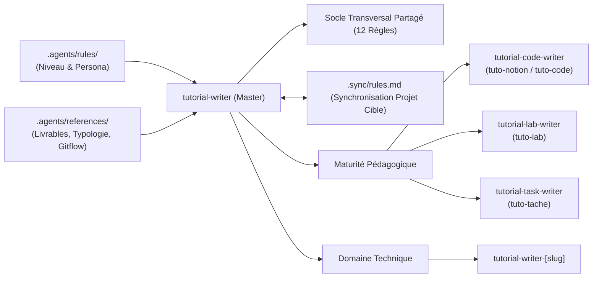

# 1. Mission & Responsabilités
Master Skill et chef d'orchestre didactique de Solicode, opérant de manière **générique et indépendante du niveau** (N1 Découvrir, N2 Prototyper, N3 Développer / Réaliser selon `.agents/rules/` et `.agents/resources/[niveau]/`).



Il assure une quadruple responsabilité cardinale :
1. **Gouvernance Transversale :** Fait respecter le socle commun invariable (encodage, formatage Markdown, organisation des livrables selon `.agents/references/organisation-livrables.md`, journalisation CLI ciblée selon `.agents/references/typologie-uas-tutoriels.md`, style A1-A2).
2. **Aiguillage Didactique :** Route vers le sous-skill spécialisé de l'écosystème `tutorial-*-writer` selon la maturité de l'UA et le type de tutoriel (`tuto-notion`, `tuto-code`, `tuto-lab`, `tuto-tache`).
3. **Règles Spécifiques par Domaine :** Combine la structure avec le skill dédié du domaine `tutorial-writer-[slug]` (`uml`, `architecture`, `laravel`, `ia`, `scrum`, `realisation-projet`, etc.).
4. **Synchronisation Inter-Agents :** Pilote de façon exclusive les échanges et le versioning avec le projet cible selon le contrat `<projet-cible>/.sync/rules.md`.

---

# 2. Déclenchement & Limites
- **Activer :** Création/refonte de tutoriels (tous niveaux) ; audit de conformité didactique ; routage vers `tutorial-*-writer` ; synchronisation des versions avec le projet cible selon `.sync/rules.md`.
- **Ne PAS activer :** Planification globale de session/stubs ➔ `didactique-tutorial-planner` | Alignement session/flux opérationnel ➔ `didactique-session-planner` | Layouts/CSS Jekyll ➔ `dev-jekyll` | Synchronisation Core Theme ➔ `sync-theme`.

---

# 3. Entrées & Ressources à Charger
- **Normes Centralisées des Livrables & Typologie :** `.agents/references/organisation-livrables.md` et `.agents/references/typologie-uas-tutoriels.md`.
- **Stratégie Git & Identité de l'Agent :** `.agents/references/gitflow.md` et `.agents/rules/persona.md`.
- **Contrat Inter-Agents :** `<projet-cible>/.sync/rules.md` (consultation obligatoire avant tout échange/synchronisation).
- **Configuration Dynamique :** Directives du niveau actif dans `.agents/rules/` et standards techniques dans `.agents/rules/standards-techniques.md`.
- **Référentiel Cible :** Dépôt physique du projet cible, arborescence miroir des versions `<projet-cible>/.sync/` et livrables sous `tutoriels/` ou racine (`src/`, `docs/`, `sprints/`).
- **Plans & Sessions :** Plans de réalisation de domaine `_tutos/_plan-tuto-*.md` et session active `_sessions/S[X].md`.

---

# 4. Contraintes & Règles Inviolables Partagées (Socle Commun)
Tous les rédacteurs `tutorial-*-writer` appliquent obligatoirement ces 12 règles :
1. **Encodage Strict :** UTF-8 sans BOM sur tous les fichiers (`.md`, `.command.md`, code).
2. **Formatage Markdown Colonne 0 :** Tout bloc de code débute strictement à la colonne 0 (zéro espace, même sous une liste), précédé et suivi d'une ligne vide.
3. **Organisation des Livrables & Arborescence Canonique :** Régie par `.agents/references/organisation-livrables.md`. Les livrables d'apprentissage hors projet d'imitation (`tuto-notion`, `tuto-lab`) sont déposés sous `tutoriels/[slug-domaine]/[slug-ua]/[slug-tuto]/`. Le code source du projet d'imitation (`tuto-code`) est déposé sous `src/` (ou structure standard du framework). Les livrables opérationnels (`tuto-tache`) sont positionnés aux emplacements racine (`docs/`, `sprints/`, `src/`). Interdiction formelle du dossier `labs/`. Le fichier `README.md` est autorisé uniquement au niveau racine `tutoriels/README.md` (aucun `README.md` dans les sous-dossiers).
4. **Rapport d'Exécution CLI (`[slug-tuto].command.md`) :** Régie par `.agents/references/typologie-uas-tutoriels.md`. Requis **uniquement** pour les tutoriels `tuto-lab`, `tuto-notion` et `tuto-code` comportant des manipulations en ligne de commande. **Formellement proscrit pour les fiches `UA-Tâche` (`tuto-tache`)** (la tâche opérationnelle impacte directement les fichiers de projet à la racine). Consigner les commandes utiles en bloc ```` ```bash ```` brut (sans double encapsulation). Interdiction formelle d'y inclure les commandes Git (`add`, `commit`, `push`). Omettre si aucune commande CLI.
5. **Environnement & Commandes :** Terminal dictated par `.agents/rules/`. Commandes universelles compatibles (`mkdir`, redirection standard `echo "" > <fichier>`, proscrire `touch` et `New-Item`).
6. **Versionnement Git & Commits Atomiques :** Régie par `.agents/references/gitflow.md` et `.agents/rules/persona.md`. Les travaux sont versionnés sur la branche unique du sprint (`sprintX`). Interdiction formelle d'ajouter des étapes directives de commit ou push (`git add`, `git commit`, `git push`) à la fin des tutoriels (autonomie de l'apprenant N2/N3).
7. **Ciblage du Projet Cible :** Les consignes et exemples ciblent le projet d'imitation configuré dans `.agents/rules/` (*Blog de l'EFP* en N1/N2, *Blog des Lauréats* en N3).
8. **Zéro Fuite de Cuisine Interne Didactique :** Interdiction d'exposer aux apprenants des termes internes (« 20/80 », « Règle des 20/80 », « Ce que l'apprenant doit produire »). Utiliser « Notions fondamentales » et « Recherches à effectuer ».
9. **Terminologie Directe :** Utiliser exclusivement le terme « Étape » (`1. **Étape 1 — ... :**`). Le terme « Jalon » est proscrit.
10. **Neutralité Technologique :** Désigner les frameworks par leur nom générique (ex: `Laravel`, `Alpine.js`) sans numéro de version éphémère dans le tutoriel (version définie dans le `README.md` du projet).
11. **Exclusion des Outils Formateur :** Le dossier `flux-travail/` ne doit jamais être transmis aux apprenants ni figurer dans les commandes `mkdir`.
12. **Zéro Capture d'Écran :** Tout livrable est du code source ou du markdown versionné.

---

# 5. Procédure d'Aiguillage Didactique & Technique
`tutorial-writer` orchestre la double délégation structurelle et technique selon `.agents/references/typologie-uas-tutoriels.md` :
1. **Délégation par Typologie Didactique :**
   - **`UA-Tuto` ➔ [tutorial-code-writer](../tutorial-code-writer/SKILL.md) :**
     - **`tuto-notion` :** Notion & syntaxe isolée hors imitation (pratique dans `tutoriels/`, pas de Marp, `[slug-tuto].command.md` si CLI).
     - **`tuto-code` :** Progression incrémentale pas-à-pas ($E_{n-1} \to E_n$) intégrée à l'imitation (code dans `src/`, pas de Marp, `[slug-tuto].command.md` si CLI).
   - **`UA-Lab` (`tuto-lab`) ➔ [tutorial-lab-writer](../tutorial-lab-writer/SKILL.md) :** Atelier pratique guidé (notions fondamentales, recherche active, modélisation, outillage IA, diaporama Marp obligatoire `presentation-[slug-tuto].md`, `[slug-tuto].command.md` si CLI).
   - **`UA-Tâche` (`tuto-tache`) ➔ [tutorial-task-writer](../tutorial-task-writer/SKILL.md) :** Cadrage opérationnel et cérémonies agiles Scrum (0% théorie, livrables aux emplacements racine du projet, **zéro `.command.md`**, **zéro diaporama Marp**).
2. **Injection des Règles Spécifiques de Domaine (`tutorial-writer-[slug]`) :**
   - Applique les exigences, outils et syntaxes du domaine cible (`uml`, `architecture`, `laravel`, `ia`, `scrum`, `realisation-projet`, etc.).

---

# 6. Protocole de Synchronisation Inter-Agents (`.sync/rules.md`)
Les échanges avec le projet cible appliquent rigoureusement le contrat `<projet-cible>/.sync/rules.md` :

| Dimension | Agent Réalisation (Agent Projet) | Agent Autoformation (`tutorial-writer`) |
| :--- | :--- | :--- |
| **Rôle Principal** | Réalise les fonctionnalités, fiches, diaporamas Marp et code dans le projet cible. | Maintient `_tutos/`, audite et synchronise les parcours pédagogiques dans Jekyll. |
| **Gestion des Versions** | Crée/incrémente les `version.yml` **exclusivement dans `.sync/`** (ex: `fichier.md: "1.0.0"`). Interdiction formelle hors de `.sync/`. | Lit `.sync/.../version.yml` et compare avec les versions déclarées dans le front-matter du tutoriel. |
| **Notification** | Renseigne dans le front-matter de `_tutos/` : `sprint`, `statut_realisation: "realise"` et la liste des `livrables` (chemins + versions). | Si version `.sync/` > front-matter : met à jour le contenu réel, aligne la version et passe `statut_realisation: "synchronise"`. Si livrable défaillant : passe `statut_realisation: "a_adapter"`. |
| **Adaptation Mutuelle** | Si livrable incomplet/décalé : corrige et adapte le livrable dans `tutoriels/` ou racine. | Si le projet valide une solution plus pertinente : met à jour le tutoriel de référence dans `_tutos/`. |

---

# 7. Format de Sortie & Frontmatter Canonique
```markdown
---
layout: tuto
title: "Titre du Tutoriel"
sous_titre: "Sous-titre technique"
tuto_id: "T.XXX.YYY"
ua: "UA.XXX.YY"
nav_order: 10
simplified: true
branche: "sprint1"
sprint: "sprint1"
statut_realisation: "realise" # realise | synchronise | a_adapter
livrables:
  - chemin: "tutoriels/[slug-domaine]/[slug-ua]/[slug-tuto]/[slug-tuto].md"
    version: "1.0.0"
  - chemin: "tutoriels/[slug-domaine]/[slug-ua]/[slug-tuto]/presentation-[slug-tuto].md"
    version: "1.0.0"
---
```

---

# 8. Contrôle Qualité (Checklist Binaire)
- [ ] Encodage UTF-8 sans BOM et blocs de code colonne 0 sans indentation.
- [ ] Livrable conforme à `.agents/references/organisation-livrables.md` et `.agents/references/typologie-uas-tutoriels.md` (aucun `README.md` unitaire).
- [ ] Rapport CLI `[slug-tuto].command.md` présent uniquement pour `tuto-lab`, `tuto-notion`, `tuto-code` comportant du CLI (strictement absent pour `tuto-tache`).
- [ ] Diaporama Marp `presentation-[slug-tuto].md` présent uniquement pour `tuto-lab`.
- [ ] Zéro commande Git d'administration dans les tutoriels et les fichiers `.command.md` ; respect de `.agents/references/gitflow.md`.
- [ ] Zéro terme interdit (« 20/80 », « Jalon », captures d'écran) ; généricité respectée (zéro chemin dur).
- [ ] **Protocole .sync/ :** Consultation préalable de `.sync/rules.md` ; zéro `version.yml` hors de `.sync/` ; versions et statut (`synchronise` / `a_adapter`) alignés dans le front-matter.

---

# 9. Gestion des Erreurs Fréquentes
| Erreur Constatée | Cause | Solution Immédiate |
| :--- | :--- | :--- |
| `version.yml` présent dans `tutoriels/` ou `src/` | Violation d'isolation `.sync/` | Déplacer immédiatement sous `.sync/.../version.yml` |
| Version déclarée front-matter $\neq$ `.sync/` | Évolution non répercutée | Aligner les extraits Jekyll, mettre à jour la version et passer `statut_realisation: "synchronise"` |
| Livrable incomplet ou code cassant | Discordance technique | Passer `statut_realisation: "a_adapter"` dans le front-matter |
| Bloc de code indenté sous une puce | Erreur Markdown | Aligner strictement colonne 0 avec saut de ligne avant et après |
| Étape `git commit/push` imposée en N2/N3 | Non-respect d'autonomie | Supprimer l'étape selon les règles du niveau actif |
| Mention de « Règle des 20/80 » | Fuite didactique interne | Remplacer par « Notions fondamentales » et « Recherches à effectuer » |
| `[slug-tuto].command.md` créé pour un `tuto-tache` | Non-respect de la typologie | Supprimer le fichier .command.md (non requis pour une tâche opérationnelle) |

---

# 10. Exemples Concrets d'Aiguillage
- **Notion de code isolée :** Pratique syntaxique hors projet d'imitation ➔ **`tutorial-code-writer`** (`tuto-notion`).
- **Code incrémental d'application :** Création d'un composant/route pas-à-pas ($E_{n-1} \to E_n$) sur l'imitation ➔ **`tutorial-code-writer`** (`tuto-code`) + **`tutorial-writer-laravel`**.
- **Atelier guidé :** Modélisation UML ➔ **`tutorial-lab-writer`** (`tuto-lab`) + **`tutorial-writer-uml`** ; Conception d'architecture ➔ **`tutorial-lab-writer`** (`tuto-lab`) + **`tutorial-writer-architecture`** ; Outillage IA RIO ➔ **`tutorial-lab-writer`** (`tuto-lab`) + **`tutorial-writer-ia`**.
- **Tâche de projet :** Cérémonie opérationnelle (0% théorie) ➔ **`tutorial-task-writer`** (`tuto-tache`) + **`tutorial-writer-realisation-projet`**.
