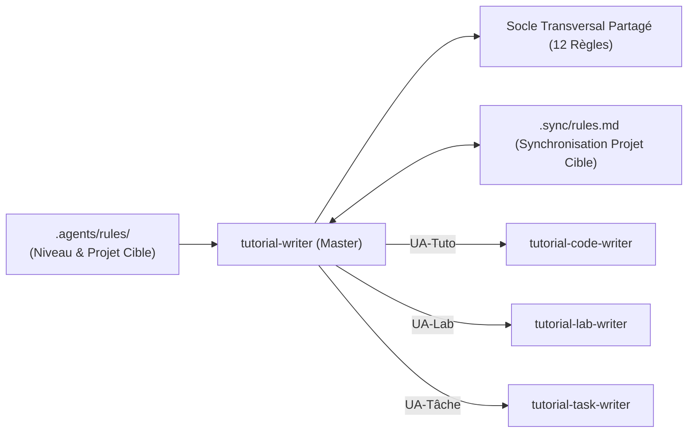

# 1. Mission & Responsabilités
Master Skill et chef d'orchestre didactique de Solicode, opérant de manière **générique et indépendante du niveau** (N1 Découvrir, N2 Prototyper, N3 Développer / Réaliser selon `.agents/rules/` et `.agents/resources/[niveau]/`).



Il assure une triple responsabilité cardinale :
1. **Gouvernance Transversale :** Fait respecter le socle commun invariable (encodage, formatage Markdown, arborescence `tutoriels/`, journalisation CLI, style A1-A2).
2. **Aiguillage Didactique :** Route vers le sous-skill spécialisé de l'écosystème `tutorial-*-writer` selon la maturité de l'UA (`UA-Tuto`, `UA-Lab`, `UA-Tâche`).
3. **Synchronisation Inter-Agents :** Pilote de façon exclusive les échanges et le versioning avec le projet cible selon le contrat `<projet-cible>/.sync/rules.md`.

---

# 2. Déclenchement & Limites
- **Activer :** Création/refonte de tutoriels (tous niveaux) ; audit de conformité didactique ; routage vers `tutorial-*-writer` ; synchronisation des versions avec le projet cible selon `.sync/rules.md`.
- **Ne PAS activer :** Planification globale de session/stubs ➔ `tutorial-planer` | Alignement session/flux opérationnel ➔ `session-flux-travail-adapter` | Layouts/CSS Jekyll ➔ `dev-jekyll` | Synchronisation Core Theme ➔ `sync-theme`.

---

# 3. Entrées & Ressources à Charger
- **Contrat Inter-Agents :** `<projet-cible>/.sync/rules.md` (consultation obligatoire avant tout échange/synchronisation).
- **Configuration Dynamique :** Directives du niveau actif dans `.agents/rules/` (profil, règles Git, terminal) et standards techniques dans `.agents/rules/standards-techniques.md`.
- **Référentiel Cible :** Dépôt physique du projet cible, arborescence miroir des versions `<projet-cible>/.sync/` et livrables sous `tutoriels/`.
- **Plans & Sessions :** Plans de réalisation de domaine `_tutos/_plan-tuto-*.md` et session active `_sessions/S[X].md`.

---

# 4. Contraintes & Règles Inviolables Partagées (Socle Commun)
Tous les rédacteurs `tutorial-*-writer` appliquent obligatoirement ces 12 règles :
1. **Encodage Strict :** UTF-8 sans BOM sur tous les fichiers (`.md`, `.command.md`, code).
2. **Formatage Markdown Colonne 0 :** Tout bloc de code débute strictement à la colonne 0 (zéro espace, même sous une liste), précédé et suivi d'une ligne vide.
3. **Arborescence Canonique des Livrables :** Chemin relatif obligatoire `tutoriels/[slug-domaine]/[slug-ua]/[slug-tuto]/`. Proscrire les dossiers orphelins (ex: `labs/`), les `README.md` dans les sous-dossiers de tutoriels unitaires et les mentions floues sans chemin explicite.
4. **Journalisation CLI Standardisée (`[slug-tuto].command.md`) :** Si la tâche comporte des commandes terminal, consigner les commandes utiles dans `[slug-tuto].command.md` en bloc ```` ```bash ```` brut (sans double encapsulation). Interdiction formelle d'y inclure les commandes Git (`add`, `commit`, `push`). Omettre si aucune commande CLI.
5. **Environnement & Commandes :** Terminal dictated par `.agents/rules/`. Commandes universelles compatibles (`mkdir`, redirection standard `echo "" > <fichier>`, proscrire `touch` et `New-Item`).
6. **Versionnement Git selon le Niveau Actif :** Si le niveau actif prescrit l'autonomie Git (ex: N2/N3), interdiction formelle d'ajouter des étapes de commit/push (`git add`, `git commit`, `git push`) à la fin des tutoriels. Si le niveau prescrit un apprentissage dirigé (ex: N1), appliquer les consignes locales de `.agents/rules/`.
7. **Ciblage du Projet Cible :** Les consignes et exemples ciblent le projet d'application ou d'imitation configuré dans `.agents/rules/`.
8. **Zéro Fuite de Cuisine Interne Didactique :** Interdiction d'exposer aux apprenants des termes internes (« 20/80 », « Règle des 20/80 », « Ce que l'apprenant doit produire »). Utiliser « Notions fondamentales » et « Recherches à effectuer ».
9. **Terminologie Directe :** Utiliser exclusivement le terme « Étape » (`1. **Étape 1 — ... :**`). Le terme « Jalon » est proscrit.
10. **Neutralité Technologique :** Désigner les frameworks par leur nom générique (ex: `Laravel`, `Alpine.js`) sans numéro de version éphémère dans le tutoriel (version définie dans le `README.md` du projet).
11. **Exclusion des Outils Formateur :** Le dossier `flux-travail/` ne doit jamais être transmis aux apprenants ni figurer dans les commandes `mkdir`.
12. **Zéro Capture d'Écran :** Tout livrable est du code source ou du markdown versionné.

---

# 5. Procédure d'Aiguillage Didactique
`tutorial-writer` qualifie la maturité de l'UA et délègue au sous-skill spécialisé :
- **`maturite: "UA-Tuto"` ➔ [tutorial-code-writer](../tutorial-code-writer/SKILL.md) :** Apprentissage de code incrémental pas-à-pas ($E_{n-1} \to E_n$), manipulation élémentaire, injecteur `window.pageData` pour l'éditeur interactif.
- **`maturite: "UA-Lab"` ➔ [tutorial-lab-writer](../tutorial-lab-writer/SKILL.md) :** Atelier pratique guidé (notions fondamentales, recherche active, modélisation UML/schémas, outillage par prompts/skills réutilisables).
- **`maturite: "UA-Tâche"` ➔ [tutorial-task-writer](../tutorial-task-writer/SKILL.md) :** Tâche opérationnelle de projet, cadrage ou cérémonies agiles Scrum sans aucun apport théorique (0% théorie).

---

# 6. Protocole de Synchronisation Inter-Agents (`.sync/rules.md`)
Les échanges avec le projet cible appliquent rigoureusement le contrat `<projet-cible>/.sync/rules.md` :

| Dimension | Agent Réalisation (Agent Projet) | Agent Autoformation (`tutorial-writer`) |
| :--- | :--- | :--- |
| **Rôle Principal** | Réalise les fonctionnalités, fiches, diaporamas Marp et code dans le projet cible. | Maintient `_tutos/`, audite et synchronise les parcours pédagogiques dans Jekyll. |
| **Gestion des Versions** | Crée/incrémente les `version.yml` **exclusivement dans `.sync/`** (ex: `fichier.md: "1.0.0"`). Interdiction formelle hors de `.sync/`. | Lit `.sync/.../version.yml` et compare avec les versions déclarées dans le front-matter du tutoriel. |
| **Notification** | Renseigne dans le front-matter de `_tutos/` : `sprint`, `statut_realisation: "realise"` et la liste des `livrables` (chemins + versions). | Si version `.sync/` > front-matter : met à jour le contenu réel, aligne la version et passe `statut_realisation: "synchronise"`. Si livrable défaillant : passe `statut_realisation: "a_adapter"`. |
| **Adaptation Mutuelle** | Si livrable incomplet/décalé : corrige et adapte le livrable dans `tutoriels/`. | Si le projet valide une solution plus pertinente : met à jour le tutoriel de référence dans `_tutos/`. |

---

# 7. Format de Sortie & Frontmatter Canonique
```markdown
---
layout: tuto
title: "Titre du Tutoriel"
sous_titre: "Sous-titre technique"
tuto_id: "T.XXX.YYY"
ua: "UA.XXX.YY"
nav_order: 10
simplified: true
branche: "sprint1"
sprint: "sprint1"
statut_realisation: "realise" # realise | synchronise | a_adapter
livrables:
  - chemin: "tutoriels/[slug-domaine]/[slug-ua]/[slug-tuto]/[slug-tuto].md"
    version: "1.0.0"
  - chemin: "tutoriels/[slug-domaine]/[slug-ua]/[slug-tuto]/presentation-[slug-tuto].md"
    version: "1.0.0"
---
```

---

# 8. Contrôle Qualité (Checklist Binaire)
- [ ] Encodage UTF-8 sans BOM et blocs de code colonne 0 sans indentation.
- [ ] Livrable sous `tutoriels/[slug-domaine]/[slug-ua]/[slug-tuto]/` sans `README.md` unitaire.
- [ ] Journalisation `[slug-tuto].command.md` sans commande Git ; versionnement conforme au niveau actif.
- [ ] Zéro terme interdit (« 20/80 », « Jalon », captures d'écran) ; généricité respectée (zéro chemin dur).
- [ ] **Protocole .sync/ :** Consultation préalable de `.sync/rules.md` ; zéro `version.yml` hors de `.sync/` ; versions et statut (`synchronise` / `a_adapter`) alignés dans le front-matter.

---

# 9. Gestion des Erreurs Fréquentes
| Erreur Constatée | Cause | Solution Immédiate |
| :--- | :--- | :--- |
| `version.yml` présent dans `tutoriels/` ou `src/` | Violation d'isolation `.sync/` | Déplacer immédiatement sous `.sync/.../version.yml` |
| Version déclarée front-matter $\neq$ `.sync/` | Évolution non répercutée | Aligner les extraits Jekyll, mettre à jour la version et passer `statut_realisation: "synchronise"` |
| Livrable incomplet ou code cassant | Discordance technique | Passer `statut_realisation: "a_adapter"` dans le front-matter |
| Bloc de code indenté sous une puce | Erreur Markdown | Aligner strictement colonne 0 avec saut de ligne avant et après |
| Étape `git commit/push` imposée en N2/N3 | Non-respect d'autonomie | Supprimer l'étape selon les règles du niveau actif |
| Mention de « Règle des 20/80 » | Fuite didactique interne | Remplacer par « Notions fondamentales » et « Recherches à effectuer » |

---

# 10. Exemples Concrets d'Aiguillage
- **Code incrémental :** Création d'un composant/route pas-à-pas ($E_{n-1} \to E_n$) ➔ **`tutorial-code-writer`**.
- **Atelier guidé :** Modélisation UML, assimilation d'architecture, outillage IA ➔ **`tutorial-lab-writer`**.
- **Tâche de projet :** Cadrage initial, Sprint Planning, Review, Rétrospective (0% théorie) ➔ **`tutorial-task-writer`**.
